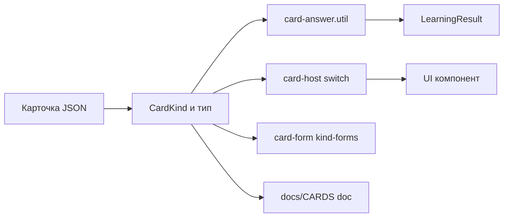

# План: новые виды карточек в LinguaCode

> Статус: черновик для согласования
> Относится к: `entities/card`, `features/card-editor`, `docs/CARDS/*`, `public/data/cards/*`
> Контекст: брейнсторм вариантов карточек → отбор MVP-набора → поэтапная реализация

## 1. Цель и рамки

Расширить каталог видов карточек (`CardKind`) четырьмя группами фич:

- **Фаза 1 (MVP)** — новые виды, переиспользующие существующую механику:
  `flip` (переворот), `cloze` (пропуск), `code-trace` («что выведет код»).
- **Фаза 1.5 (контентные вариации)** — без нового кода, только данные и доки:
  `true-false`, `odd-one-out`, `minimal-pair` (реализуются поверх существующих `select` / `sound`).
- **Фаза 2** — структурные виды с новым паттерном интеракции:
  `scramble` (собери предложение), `sequence` (порядок элементов), `repair` (найди ошибку),
  расширение `tone` до многосложных слов и сандхи.
- **Фаза 3 (стратегические)** — SRS-планировщик на базе `flip`, `record` (shadowing),
  `matching` (drag-n-drop), `image-select` (поле `imageUrl`).

Критерии отбора: цена реализации (переиспользование существующих компонентов и утилит),
покрытие новых когнитивных навыков, ценность для контента языков и программирования (C++/Perl).

## 2. Текущая архитектура: точки расширения

Каждый новый вид проходит один и тот же путь. Изменяемые файлы:

| #   | Слой     | Файл                                                                                                                                                                                   | Что делаем                                                                             |
| --- | -------- | -------------------------------------------------------------------------------------------------------------------------------------------------------------------------------------- | -------------------------------------------------------------------------------------- |
| 1   | Модель   | [`card.types.ts`](src/app/entities/card/model/card.types.ts:10)                                                                                                                        | литерал в `CardKind`, новый тип, вхождение в `Card` и при необходимости в `OptionCard` |
| 2   | Проверка | [`card-interaction.types.ts`](src/app/entities/card/model/card-interaction.types.ts:20)                                                                                                | новые поля `CardAnswerState` для новых паттернов интеракции                            |
| 3   | Проверка | [`card-answer.util.ts`](src/app/entities/card/lib/card-answer/card-answer.util.ts:233)                                                                                                 | ветви в `canCheckCardAnswer` / `checkCardAnswer` / `getCorrectAnswerLabel`             |
| 4   | UI       | `src/app/entities/card/ui/cards/<kind>-card/`                                                                                                                                          | компонент + `_quiz-card.scss` + barrel `index.ts`                                      |
| 5   | Host     | [`card-host.component.html`](src/app/entities/card/ui/card-host/card-host.component.html:6) и [`card-host.component.ts`](src/app/entities/card/ui/card-host/card-host.component.ts:38) | `@case` + входные/выходные сигналы, импорт компонента                                  |
| 6   | Legacy   | [`card-legacy.mapper.ts`](src/app/entities/card/mapping/card-legacy.mapper.ts:47)                                                                                                      | ветвь нормализации старых форматов                                                     |
| 7   | Редактор | `src/app/features/card-editor/components/card-form/`                                                                                                                                   | kind-form (переиспользовать choice/input/pairs/code-select или новая)                  |
| 8   | Доки     | [`docs/CARDS/`](docs/CARDS) + [`CARD-FIELD-GUIDE.md`](docs/COMMON/CARD-FIELD-GUIDE.md) + [`CARD-CATALOG.md`](docs/COMMON/CARD-CATALOG.md:60)                                           | карточка вида, поля, фасет `kinds`                                                     |
| 9   | Данные   | `public/data/cards/*.json` + `content-manifest.json`                                                                                                                                   | примеры карточек (в т.ч. для C++ concurrency)                                          |
| 10  | Тесты    | `*.spec.ts` рядом с изменяемыми модулями                                                                                                                                               | модель, проверка ответов, компонент                                                    |

Гарантии CI: `npm run verify` (lint + audit FSD + проверка импортов + barrel-экспорты + build + тесты).



## 3. Матрица новых видов

| Вид            | Навык                  | Механика проверки              | Переиспользование                            | Фаза |
| -------------- | ---------------------- | ------------------------------ | -------------------------------------------- | ---- |
| `flip`         | запоминание (база SRS) | самопроверка (Знаю / Не знаю)  | `lexeme` поля, аудио                         | 1    |
| `cloze`        | лексика в контексте    | ввод или выбор                 | `keyboard` / option-паттерн                  | 1    |
| `code-trace`   | чтение кода            | выбор вывода                   | `code-select` + `OptionCard`                 | 1    |
| `true-false`   | понимание              | выбор 2 вариантов              | `select` (контент)                           | 1.5  |
| `odd-one-out`  | категоризация          | выбор лишнего                  | `select` (контент)                           | 1.5  |
| `minimal-pair` | аудиоразличение        | выбор из 2 похожих             | `sound` (контент)                            | 1.5  |
| `scramble`     | порядок слов           | сборка из токенов              | новый паттерн + `CardAnswerState.tokenOrder` | 2    |
| `sequence`     | порядок элементов      | расстановка порядка            | тот же паттерн                               | 2    |
| `repair`       | поиск ошибок           | клик по ошибочному сегменту    | select-подобный                              | 2    |
| `tone`+        | тоны слов и сандхи     | выбор последовательности тонов | расширение `ToneCard`                        | 2    |
| `record`       | произношение           | запись и самопроверка          | `playLearningAudio` + `MediaRecorder`        | 3    |
| `matching`     | пары лексики           | drag-n-drop соответствия       | `MemoryCard.pairs`                           | 3    |
| `image-select` | визуальная лексика     | выбор по картинке              | `select` + `imageUrl`                        | 3    |
| SRS            | удержание              | интервальные повторы           | поверх `flip`                                | 3    |

## 4. Фаза 1 — MVP: три новых вида

### 4.1 `flip` — переворот

Модель в [`card.types.ts`](src/app/entities/card/model/card.types.ts):

```ts
export type FlipCard = CardBase &
  LexemeCardFields & {
    kind: 'flip';
    direction: CardDirection;
    /** Лицевая сторона — на известном языке. */
    front: string;
    frontLexeme?: PhoneticLexeme;
    /** Обратная сторона — на изучаемом языке. */
    back: string;
    backLexeme?: PhoneticLexeme;
  };
```

Особенности:

- Нет вариантов и нет объективной проверки — пользователь сам сообщает результат кнопками «Знаю» / «Не знаю».
- В `CardAnswerState` добавляется `flipKnown: boolean | null`.
- `canCheckCardAnswer` возвращает `true` при `flipKnown !== null`; `checkCardAnswer` возвращает `state.flipKnown` (значение пишется в `LearningResult`).
- Направление `direction` меняет, какая сторона «лицо» (`flip` по toggle, как у `select`).
- Аудио: кнопка озвучки `back` через [`playLearningAudio`](src/app/entities/card/utils/card-learning-audio.utils.ts:58).

UI-компонент `ui/cards/flip-card/flip-card.component.ts`: анимация поворота (CSS 3D, без сторонних библиотек),
кнопки «Знаю / Не знаю», озвучка, кнопка «Проверить» не требуется.

Editor: kind-form «pairs-лайт» — два поля `front`/`back` (+фонетика). Реюз `card-form-question-tab` / `lexeme-fields`.

### 4.2 `cloze` — пропуск

Модель:

```ts
export type ClozeCard = CardBase &
  LexemeCardFields & {
    kind: 'cloze';
    direction: CardDirection;
    /** Текст с маской пропуска, например «Я ___ в Москве» или код с ____. */
    promptKnown: string;
    /** Варианты выбора. Если заданы — режим выбора, иначе — ввод. */
    options?: readonly string[];
    /** Правильный ответ (используется для проверки и подсказки). */
    correctAnswer: string;
    /** Допустимые варианты написания для режима ввода (опционально). */
    acceptedAnswers?: readonly string[];
    correctIndex?: number; // только если заданы options
  };
```

Особенности:

- Один пропуск на карточку в MVP; несколько — расширение (`blanks[]`) в след. итерации.
- Режим ввода переиспользует матчинг `keyboard`: нормализация, IPA/Pinyin/Palladius через существующие утилиты `matchesKeyboardAnswer`.
- Режим выбора — это фактически option-паттерн: добавить `cloze` с `options` в `OptionCard` и `isOptionCard`, проверка через `checkOptionCardAnswer` с `correctIndex`; `getCorrectAnswerLabel` возвращает `correctAnswer`.
- Контент: китайский (пропуск слова в предложении), C++ (пропущенный идентификатор/строка — см. открытый [`cpp-concurrency-cards.json`](public/data/cards/cpp-concurrency-cards.json:5), где «дырки» сейчас эмулируются через `code-select`).

UI: ввод — поле + подсветка; выбор — чипы/кнопки. Заголовок — реюз `QuizCardQuestionHeaderComponent`.

### 4.3 `code-trace` — «что выведет код»

Модель:

```ts
export type CodeTraceCard = CardBase & {
  kind: 'code-trace';
  caption?: string;
  code: CodeBlock;
  question?: string; // «Что выведет программа?»
  outputOptions: readonly string[]; // варианты вывода
  correctIndex: number;
};
```

Особенности:

- Option-based: входит в `OptionCard`, проверка через `checkOptionCardAnswer`; направление не применимо (как у `code-select`).
- Подсветка кода — готовый [`CodeHighlightService`](src/app/entities/card/ui/code-highlight/code-highlight.service.ts:42).
- Вывод вариантов моноширинным шрифтом; пустой вывод — опция `«(ничего)»`.
- Пример контента: C++ concurrency — «Что выведет программа с std::async?», «Сколько раз выполнится инкремент?».

UI: копия структуры `code-select-card` (код сверху, варианты снизу).

### 4.4 Чек-лист Фазы 1

Для каждого вида выполнить шаги 1–10 из таблицы §2:

1. Модель: `CardKind` + тип + `Card` (+ `OptionCard` для `cloze`-с-вариантами и `code-trace`).
2. `CardAnswerState.flipKnown` для `flip`.
3. Ветви в [`card-answer.util.ts`](src/app/entities/card/lib/card-answer/card-answer.util.ts:233) + спеки [`card-answer.util.spec.ts`](src/app/entities/card/lib/card-answer/card-answer.util.spec.ts:1).
4. Легаси-маппер.
5. UI-компоненты + barrel-экспорты (скрипт `audit-barrels.mjs`).
6. Ветки в `card-host`.
7. Kind-forms в редакторе (reuse: `input` для cloze-ввода, `choice` для cloze-выбора и code-trace, новый mini-form для flip).
8. Доки: `docs/CARDS/card-flip.md`, `card-cloze.md`, `card-code-trace.md`; обновить `CARD-FIELD-GUIDE.md`.
9. Примеры данных: по 3–5 карточек каждого вида в seed (`demo-*`, `radicals-*` или новый `cpp-*-cards.json`), добавить в `content-manifest.json`.
10. `npm run verify`.

### 4.5 Фаза 1.5 — контентные вариации без кода

Документируем паттерны и добавляем данные (без изменений в коде):

| Паттерн        | Реализация                                         | Пример                                                 |
| -------------- | -------------------------------------------------- | ------------------------------------------------------ |
| `true-false`   | `select` с `optionsLearning: ['Верно', 'Неверно']` | «std::thread::join() блокирует вызвавший поток»        |
| `odd-one-out`  | `select`, формулировка «Что лишнее?»               | `push_back`, `emplace_back`, `operator[]`, `std::find` |
| `minimal-pair` | `sound` с 2 похожими опциями                       | «процесс vs прецедент», тоны `sì` vs `sí`              |

- Раздел-паттерн в `docs/COMMON/CARD-FIELD-GUIDE.md` + примеры JSON.
- Карточки ложатся в существующие сценарии C++/Perl/радикалов без миграций.

## 5. Фаза 2 — структурные виды

### 5.1 `scramble` — собери предложение/выражение

```ts
export type ScrambleCard = CardBase &
  LexemeCardFields & {
    kind: 'scramble';
    promptKnown: string; // перевод/подсказка
    shuffledTokens: readonly string[]; // токены в перемешанном виде
    correctOrder: readonly number[]; // правильная перестановка индексов
  };
```

- Новый паттерн интеракции: клик по чипу добавляет токен в строку ответа; клик по ответу — возвращает.
- `CardAnswerState.tokenOrder: readonly number[]`; `canCheckCardAnswer` — `tokenOrder.length === correctOrder.length`; проверка — поэлементное сравнение.
- UI: `ui/cards/scramble-card/`, чипы из `MatChips`, инвалидация при feedback.

### 5.2 `sequence` — порядок элементов

```ts
export type SequenceCard = CardBase & {
  kind: 'sequence';
  caption?: string;
  prompt: string; // «Расставь строки в правильном порядке»
  items: readonly string[]; // хранятся в правильном порядке; UI перемешивает через nonce
};
```

- Тот же паттерн `tokenOrder`; правильный порядок — `[0..n-1]`.
- Применения: порядок строк кода, шаги алгоритма, черты иероглифа, реплики диалога, абзацы.
- Общий с `scramble` компонент-основа (`token-builder` family): `ui/cards/token-order/` общие части, два публичных компонента.

### 5.3 `repair` — найди и исправь ошибку

```ts
export type RepairCard = CardBase & {
  kind: 'repair';
  promptKnown: string; // текст/код с ошибкой
  segments: readonly string[]; // сегменты, один ошибочный
  errorIndex: number; // индекс ошибочного сегмента
  fix: string; // правильная замена (для подсказки)
  hint?: string;
};
```

- MVP: клик по сегменту (`selectedIndex === errorIndex` → правильно). Паттерн как у `select`, но без вариантов.
- Расширение: режим ввода правильного фрагмента (`answerText`) — проверка через `matchesKeyboardAnswer`.
- Контент: грамматические ошибки, опечатки в коде, неверный API (например, `t.join()` без `detach` в concurrency).

### 5.4 Расширение `tone` — многосложные слова и сандхи

Дополнить `ToneCard` необязательными полями (обратная совместимость):

```ts
syllables?: readonly string[];      // слоги слова, напр. ['bù', 'kěnéng']
toneSequence?: readonly ToneMark[]; // правильная последовательность тонов
```

- Если `toneSequence` задан — карточка работает в режиме «последовательность тонов» (выбор полного набора или ввод номерами, например «4-3-2»).
- Правила сандхи («一», «不», третий тон) — утилита в `entities/phonetic`, спеки.
- UI: та же структура, слог столбиком + полоска тонов.

### 5.5 Чек-лист Фазы 2

Те же шаги 1–10, плюс:

- Новые поля `CardAnswerState.tokenOrder` (+ `sequence` разделяет его).
- Общий UI-каркас `token-order` и две публичные обёртки.
- Спеки на проверку порядка (перестановки, длина, «пустая» сборка).
- Обновить `docs/CARDS/card-tone.md` (мультитон) и добавить docs для новых видов.

## 6. Фаза 3 — стратегические

| Вид/фича       | Содержание                                                                                                                       | Зависимости                 |
| -------------- | -------------------------------------------------------------------------------------------------------------------------------- | --------------------------- |
| SRS на `flip`  | Планировщик повторов (SM-2-подобный): `dueAt`, `interval`, `easeFactor` в overlay пользователя; очередь «на повторение» в сессии | `flip` (Ф1), `user/overlay` |
| `record`       | Запись через `MediaRecorder`, самопроверка + сравнение длительности; эталон через Web Speech API                                 | `playLearningAudio`         |
| `matching`     | Две колонки, drag-n-drop (CDK) соответствий; данные — `MemoryPair`                                                               | `memory`                    |
| `image-select` | `imageUrl?: string` в `LexemeCardFields`; `select`-механика с картинкой                                                          | Ф1.5                        |

Каждая — отдельный мини-план по шагам §2; SRS и `image-select` требуют миграций overlay/модели — выносятся в отдельные задачи с документацией миграций.

## 7. Критерии готовности (Definition of Done)

Для каждого нового вида:

1. `CardKind` включает новый литерал; тип покрыт type-guard'ами (`isOptionCard` и пр.).
2. Проверка ответа корректна для всех режимов и направлений, покрыта спеками.
3. Компонент рендерится в `card-host` и в preview/try-dialog редактора.
4. Редактор позволяет создать карточку вида (wizard + kind-form), валидация полей.
5. Legacy-маппер не ломает старые данные; старые спеки зелёные.
6. Barrels и FSD-аудиты проходят (`audit-barrels.mjs`, `audit-fsd.mjs`).
7. Документация вида в `docs/CARDS/`, поля в `CARD-FIELD-GUIDE.md`.
8. Примеры данных в каталоге контента и в `content-manifest.json`.
9. `npm run verify` зелёный.

## 8. Риски и решения

| Риск                                            | Митигация                                                                                                            |
| ----------------------------------------------- | -------------------------------------------------------------------------------------------------------------------- |
| Рост `CardKind` усложняет `card-answer.util`    | Держать проверки в switch-утилитах + type-guards; новые option-виды автоматически идут через `checkOptionCardAnswer` |
| Фаза 2 добавляет новые поля в `CardAnswerState` | Поля опциональны и независимы; `createCardAnswerState` — единая фабрика, спека обновится                             |
| Новые UI-компоненты без дизайн-токенов          | Реюз `_quiz-card.scss`, темы `appearance.theme`, паттерны `select-card`                                              |
| Редактор (wizard G12) не покрывает token-виды   | Одна новая kind-form «token-order» на `scramble`/`sequence`/`repair`                                                 |
| SRS требует миграций хранилища                  | Отдельная фаза с версионированием `user-content-overlay.migration`                                                   |
| Контент без авторов                             | Сначала seed-примеры (3–5 карточек на вид), затем каталог                                                            |

## 9. Порядок выполнения

1. Фаза 1: `flip` → `cloze` → `code-trace` (каждый — полный цикл шагов §2 + спеки).
2. Фаза 1.5: контентные паттерны + примеры JSON (C++ concurrency и китайский).
3. Фаза 2: `token-order` каркас → `scramble` → `sequence` → `repair` → `tone`-расширение.
4. Фаза 3: SRS → `record` → `matching` → `image-select` (отдельные планы/тикеты).

## 10. Связанные документы

- [`docs/COMMON/CARD-CATALOG.md`](docs/COMMON/CARD-CATALOG.md) — фасеты `kinds`, пагинация.
- [`docs/ARCHITECTURE/ARCHITECTURE.card-editor.md`](docs/ARCHITECTURE/ARCHITECTURE.card-editor.md) — kind-forms (choice, input, pairs, media, code-select).
- [`docs/COMMON/CARD-FIELD-GUIDE.md`](docs/COMMON/CARD-FIELD-GUIDE.md) — справочник полей.
- [`docs/CARDS/`](docs/CARDS) — по документу на вид.
- Модель: [`card.types.ts`](src/app/entities/card/model/card.types.ts:10); проверка: [`card-answer.util.ts`](src/app/entities/card/lib/card-answer/card-answer.util.ts:233); host: [`card-host.component.html`](src/app/entities/card/ui/card-host/card-host.component.html:6).
