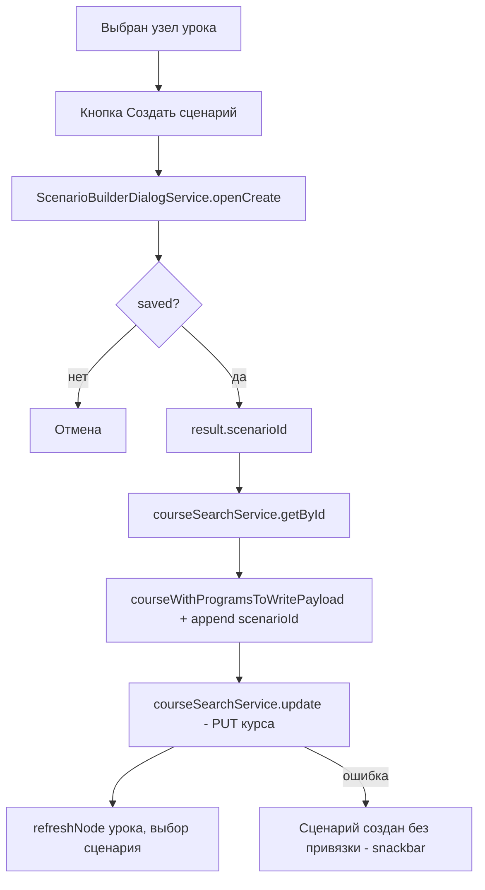

# План: Перенос функций «Конструктора сценариев» в «Проводник контента»

> Структурный шаблон — `crisp-tiger-plan-rev2.md` (миграция «Конструктора курсов», выполнена).
> Все факты в этом плане проверены по исходникам на момент написания (ревизия 1).

## Контекст

Страница `/tools/scenario-builder` (Конструктор сценариев) содержит CRUD-операции
над сценариями: список с пагинацией, поиск, scope-фильтр «Мои / Опубликованные /
Все», фильтр-чипы по курсам, создание/редактирование/просмотр (через общий
диалог `ScenarioBuilderDialogService`), удаление без подтверждения и «Повторить»
при ошибке.

Страница `/tools/content` (Проводник контента) уже содержит дерево
`Course → Program → Lesson → Scenario → Card` и открывает диалог сценария
(`ScenarioBuilderDialogService.openCreate()/openEdit()`) для создания и
редактирования. Удаление курса из Проводника уже реализовано с confirm-диалогом
(`course-delete-confirm-dialog.component.ts`).

**Известный пробел:** `onAddScenarioRequested`
(`content-explorer-page.component.ts:179-199`) создаёт сценарий, но **не
привязывает его к уроку** — snackbar предлагает «открыть конструктор курсов».

**Цель:** перенести уникальные функции управления сценариями в Проводник
контента, закрыть пробел привязки сценария к уроку, удалить страницу
`/tools/scenario-builder`, сохранить обратную совместимость через редирект.

**Ограничение (по образцу ревизии 2 плана курсов):** feature-слайс
`features/scenario-builder/` НЕ удаляется — диалог `scenario-builder-dialog`
используется Проводником, а `ScenarioBuilderStore` (`providedIn: 'root'`)
переиспользуется Проводником для каталога сценариев и удаления. Удаляется
только `pages/scenario-builder/`.

---

## Что переносится

| Функция | Куда | Обоснование |
|---------|------|-------------|
| Привязка сценария к уроку (новое, закрывает пробел) | Обработчик «+ Сценарий» на узле урока (`content-explorer-page.component.ts`) | Главный мотив миграции: сценарий создаётся из урока и сразу появляется в дереве |
| Удаление сценария (с confirm-диалогом) | Detail-панель при выбранном scenario-узле | Контекстно привязано; подтверждение по образцу `course-delete-confirm-dialog.component.ts`; проверка владения сохраняется |
| Scope-фильтр «Мои / Опубликованные / Все» | «Каталог сценариев» — панель/диалог в Проводнике (header) | Автономные (не привязанные) сценарии в дерево не попадают; им нужен отдельный список |
| Пагинация списка сценариев | «Каталог сценариев» в Проводнике | Переиспользуется `ScenarioBuilderStore.loadList/setPage` — пагинация уже реализована в store |
| Бейдж «опубликован» | Detail-панель при выбранном scenario-узле | Дерево уже показывает статус в meta (`content-explorer.store.ts:644-647`), detail-панель приводится к согласованному виду |
| Редактирование/просмотр сценария | Уже есть в Проводнике (`openEdit` → refreshNode) | Переносить нечего |
| Поиск по сценариям | Уже есть (фильтр дерева) | Не переносится |

### Что НЕ переносится

| Функция | Куда | Обоснование |
|---------|------|-------------|
| Кнопка «Повторить» при ошибке списка | Не переносится | У Проводника своя обработка ошибок (snackbar + состояние дерева) |
| Фильтр-чипы по курсам (`store.setListCourseId`) | Не переносится | Курсовой контекст в Проводнике даёт само дерево; привязка к уроку решает задачу «сценарии курса» |
| Поиск списка (`listQuery`) | Не переносится | Покрывается фильтром дерева (`filterQuery`); в «Каталоге сценариев» поиска не будет (осознанное упрощение) |
| Поля `published` / `sourceMode` / `fixedCardIds` в форме | Не возвращаются в UI | Docs drift: поля есть в `ScenarioDraft`, но UI их больше не показывает; зафиксировать в документации |

---

## Специфика привязки сценария к уроку (исследование + выбранный подход)

### Результаты исследования

1. **Связь хранится в уроке:** `Lesson.scenarioIds` — «IDs сценариев,
   привязанных к уроку» (`shared/api/generated/models/lesson.ts:18-19`);
   `course-builder.types.ts:14`, `course-pdf-export.service.ts:1047-1049`.
2. **Урок-level API привязку НЕ пишет:** `LessonUpdateRequest`
   (`shared/api/generated/models/lessonUpdateRequest.ts:11-16`) содержит только
   `title / lessonDescription / lessonOrder / prerequisiteLessonIds`. Draft
   урока сознательно исключает `scenarioIds` (`lesson-builder.types.ts:5-7`,
   `lesson-form-draft.utils.spec.ts:56-58`).
3. **Единственный путь записи привязки — обновление курса целиком:**
   `CourseWritePayload` несёт `programs[].lessons[].scenarioIds`
   (`entities/course/repository/course-catalog.port.ts:60-79`), запись через
   `courseSearchService.update(courseId, payload)` →
   `courses-api.service.ts:293-312` (PUT `/courses/{id}`); owner-check и
   нормализация — в `course-builder.store.ts:326-353, 509-559`.
4. **ID созданного сценария сейчас теряется:** `ScenarioSearchService.create`
   возвращает созданный `Scenario` (`scenario-search.service.ts:73-75`), но
   `ScenarioBuilderStore.createScenario` возвращает только `boolean`
   (`scenario-builder.store.ts:264-280`), а `ScenarioBuilderDialogResult`
   содержит только `saved` (`scenario-builder-dialog.types.ts:16-18`).

### Выбранный подход (наименее инвазивный)

Привязку выполняет **страница Проводника** (page-слой — там уже живёт
диалоговая оркестрация между фичами, FSD-совместимо):

1. `ScenarioBuilderStore.createScenario(draft)` → возвращает созданный
   `Scenario | null` вместо `boolean` (тело уже получает его из
   `scenarioSearchService.create`).
2. `ScenarioBuilderDialogResult` расширяется полем `scenarioId?: string`;
   диалог закрывается с `{ saved: true, scenarioId }` (create — из store,
   edit — из `data.scenarioId`).
3. `ScenarioBuilderDialogService` НЕ меняется (без lesson-контекста) —
   сценарная фича не начинает зависеть от course/lesson-сущностей, остальные
   точки вызова не затронуты.
4. В `content-explorer-page.component.ts.onAddScenarioRequested()` после
   `saved && scenarioId`:
   - взять выбранный lesson-узел, по `store.pathOf(node)` найти course-узел;
   - `courseSearchService.getById(courseId)` → `CourseWithPrograms`;
   - новый entity-маппер `courseWithProgramsToWritePayload(course)` (в
     `entities/course/utils/`) собрать в `CourseWritePayload`;
   - дописать `scenarioId` в `scenarioIds` целевого урока (dedupe, порядок сохранить);
   - `courseSearchService.update(courseId, payload)` +
     `courseSearchService.clearGetByIdCache()`;
   - `store.refreshNode(lessonNode)` — сценарий появляется в дереве; выбрать
     новый scenario-узел; snackbar «Сценарий создан и добавлен в урок».
5. Ошибка привязки — некритична: сценарий уже создан; snackbar «Сценарий
   создан, но не удалось привязать его к уроку — добавьте его в конструкторе
   курсов».



### Отклонённые альтернативы

| Альтернатива | Почему отклонена |
|--------------|------------------|
| Добавить `scenarioIds` в `LessonUpdateRequest` | Требует изменения бэкенда/OpenAPI и регенерации orval — вне скоупа фронтовой миграции; зафиксировать как future improvement |
| Передавать lesson-контекст в `ScenarioBuilderDialogService` и привязывать внутри диалога | Связывает scenario-фичу с course-сущностями и меняет поведение всех вызовов диалога |
| Переиспользовать `CourseBuilderStore.updateCourse` | `normalizeDraft` приватен и навязывает валидацию «в каждом уроке ≥ 1 сценарий» (`course-builder.store.ts:550-557`) — не годится для точечной привязки |

---

## Этапы работ

### Этап 1: Привязка сценария к уроку

**Файлы:**
- `src/app/features/scenario-builder/services/scenario-builder.store.ts` —
  `createScenario` возвращает `Scenario | null`
- `src/app/features/scenario-builder/components/scenario-builder-dialog/scenario-builder-dialog.types.ts` —
  `ScenarioBuilderDialogResult.scenarioId?: string`
- `src/app/features/scenario-builder/components/scenario-builder-dialog/scenario-builder-dialog.component.ts` —
  передать `scenarioId` в `dialogRef.close`
- `src/app/entities/course/utils/course-write-payload.utils.ts` — **новый**
  маппер `courseWithProgramsToWritePayload` (+ spec)
- `src/app/entities/course/index.ts` — экспорт маппера
- `src/app/pages/content-explorer/content-explorer-page/content-explorer-page.component.ts` —
  новая логика в `onAddScenarioRequested()`

**Действия:**
1. Реализовать маппер `CourseWithPrograms → CourseWritePayload` без валидаций
   `normalizeDraft` (только маппинг полей, включая `published`, `languagePair`,
   `authoring`, `practiceSettings`, если присутствуют в модели — сверить с
   `CourseWritePayload`, `course-catalog.port.ts:71-79`).
2. Изменить `createScenario` и результат диалога (см. «Выбранный подход»).
3. Переписать `onAddScenarioRequested()`: привязка только для
   `node.kind === 'lesson'` и `node.editable`; сценарий, созданный без
   lesson-контекста, привязки не требует.
4. Обновить snackbar-тексты (убрать «откройте конструктор курсов»).

**Критерии приёмки:**
- Создание сценария из узла урока после закрытия диалога сразу показывает
  сценарий дочерним узлом урока в дереве (без конструктора курсов).
- Отмена диалога ничего не меняет; ошибка PUT не удаляет созданный сценарий.
- Существующий spec `scenario-builder.store.spec.ts` обновлён под новый
  возвращаемый тип; новый spec маппера покрывает сценарий append/dedupe.

---

### Этап 2: Удаление сценария с подтверждением

**Файлы:**
- `src/app/features/content-explorer/components/explorer-detail/explorer-detail.component.{ts,html,scss}` —
  output `deleteScenarioRequested`, computed `canEditOwnScenario()`, кнопка
  «Удалить» для scenario-узлов
- `src/app/pages/content-explorer/content-explorer-page/scenario-delete-confirm-dialog.component.ts` —
  **новый**, по образцу `course-delete-confirm-dialog.component.ts`
- `src/app/pages/content-explorer/content-explorer-page/content-explorer-page.component.ts` —
  обработчик `onDeleteScenarioRequested()`
- `src/app/features/scenario-builder/services/scenario-builder.store.ts` —
  `deleteScenario(scenarioId, entry?: ScenarioIndexEntry)`

**Действия:**
1. Кнопка «Удалить» видна только при `canEditOwnScenario()` — проверка
   `isEditableContentAuthor(scenario.authorId, …)` по данным узла (аналог
   `ScenarioBuilderStore.isReadOnly`, `scenario-builder.store.ts:85-97`; в
   дереве уже есть `editable: isOwnAuthor(...)`, `content-explorer.store.ts:488`).
2. Подтверждение через `MatDialog` (текст: «Сценарий „{title}“ будет удалён
   безвозвратно»), затем делегирование в `ScenarioBuilderStore.deleteScenario`.
3. **Устранить дыру в проверке владения:** текущий `deleteScenario`
   (`scenario-builder.store.ts:321-339`) проверяет права только если сценарий
   найден в `indexItems()` — в Проводнике сценарий обычно вне текущего списка.
   Добавить опциональный параметр `entry?: ScenarioIndexEntry`: если передан —
   проверять по нему; Проводник передаёт entry из данных узла.
4. После удаления — `store.refreshNode(parentLessonNode)`; **проверить**,
   убирает ли бэкенд id из `lesson.scenarioIds` каскадно; если нет —
   дописать обновление урока через путь Этапа 1 (уточнить на этапе).

**Критерии приёмки:**
- Удаление чужого сценария невозможно (кнопка скрыта + guard в store).
- Подтверждение обязательное; отмена ничего не удаляет.
- После подтверждения сценарий исчезает из дерева, урок обновляется.

---

### Этап 3: Бейдж «опубликован» в detail-панели

**Файлы:**
- `src/app/features/content-explorer/components/explorer-detail/explorer-detail.component.{ts,html,scss}`

**Действия:**
1. Для scenario-узлов добавить чип «Опубликован» / «Черновик» из
   `scenario.published` (источник — `node.data`).
2. Согласовать стили с чипами shared/shared-карточек, если есть.

**Критерии приёмки:** бейдж отражает фактический статус и совпадает с meta
строкой дерева.

---

### Этап 4: Scope-фильтр и «Каталог сценариев» (пагинация)

**Файлы:**
- `src/app/pages/content-explorer/content-explorer-page/content-explorer-page.component.{ts,html,scss}` —
  кнопка «Каталог сценариев» в header + панель/диалог списка
- `src/app/features/scenario-builder/services/scenario-builder.store.ts` —
  без изменений логики: `loadList`, `setListScope`, `setPage`,
  `listScope/pageIndex/pageSize/totalItems` уже есть
  (`scenario-builder.store.ts:106-129, 183-208`)

**Действия:**
1. В header Проводника добавить кнопку «Каталог сценариев», открывающую
   панель списка (реализация — inline-секция или `MatDialog`-панель; выбрать
   inline-секцию с `@if`, чтобы не плодить ещё один диалог): scope-тумблер
   «Мои / Опубликованные / Все» (`setListScope`), пагинация
   (`setPage` + счётчик `totalItems`), кнопки «Редактировать»
   (`scenarioBuilderDialog.openEdit(id)` → после сохранения ничего в дереве
   не менять — автономные сценарии в дереве не живут), кнопка
   «Создать сценарий» без привязки (текущее поведение `openCreate()`).
2. Пагинация списка сценариев — полноценная (page/pageSize из store);
   дерево при этом остаётся как есть: сценарии урока грузятся по
   `lesson.scenarioIds` без пагинации (`content-explorer.store.ts:459-492`) —
   осознанное ограничение, задокументировать.
3. `ROOT_PAGE_SIZE = 100` (`content-explorer.store.ts:31`) касается только
   корней-курсов и сценарии не ограничивает — отдельно не трогаем.

**Критерии приёмки:** переключение scope сбрасывает на страницу 0; pagination
работает; созданный/отредактированный из каталога сценарий корректно
открывается на редактирование.

---

### Этап 5: Удаление страницы и роутинга

**Файлы:**
- `src/app/pages/scenario-builder/` — удалить целиком (**только pages, не features!**)
- `src/app/app/app.routes.ts:141-149` — заменить route на redirect
- `src/app/widgets/sidebar-navigation-left/sidebar-nav-config.ts:41-46` — удалить пункт
- `src/app/widgets/sidebar-navigation-left/sidebar-nav-config.spec.ts:41-43` — убрать ожидание пункта
- `src/app/widgets/menu-tools/menu-tools.component.html:20-21` — удалить ссылку
- `src/app/pages/help/help-page/help-page.data.ts:57-58` — перевести карточку на `/tools/content`
- `src/app/pages/help-usage-scenarios/help-usage-scenarios-page/help-usage-scenarios.data.ts:80-81` — CTA на `/tools/content`

**Действия:**
1. В `app.routes.ts` заменить route (по образцу `app.routes.ts:139`):
   ```typescript
   {
     path: 'tools/scenario-builder',
     redirectTo: 'tools/content',
     pathMatch: 'full',
   },
   ```
   Оба маршрута под `authorGuard` (`app.routes.ts:134,148`) — редирект безопасен.
2. Удалить `pages/scenario-builder/` (включая
   `scenario-builder-page.component.spec.ts`).
3. Удалить пункт сайдбара, ссылку в `menu-tools`, обновить обе help-страницы
   (иначе останутся битые ссылки).
4. **НЕ удалять** `features/scenario-builder/` — диалог, store и types
   используются Проводником; почистить barrel `features/scenario-builder/index.ts`
   от экспортов удалённых частей, если появятся битые ссылки.

**Роли:** CRUD сценариев остаётся AUTHOR/ADMIN
(`docs/ARCHITECTURE/ARCHITECTURE.roles-zones.md:52`); Проводник уже под
`authorGuard` — изменений прав не требуется.

---

### Этап 6: Тесты

**Файлы:**
- `src/app/app/scenario-builder.smoke.spec.ts` — **новый**, аналог
  `course-builder.smoke.spec.ts` (навигация `/tools/scenario-builder` →
  проверка редиректа на `/tools/content`)
- `src/app/features/scenario-builder/services/scenario-builder.store.spec.ts` —
  новый возвращаемый тип `createScenario`, `deleteScenario` с `entry`
- `src/app/features/scenario-builder/components/scenario-builder-dialog/scenario-builder-dialog.component.spec.ts` —
  результат закрытия с `scenarioId`
- `src/app/features/content-explorer/components/explorer-detail/explorer-detail.component.spec.ts` —
  кнопка удаления + гейтинг `canEditOwnScenario()`, бейдж published
- `src/app/features/content-explorer/services/content-explorer.store.spec.ts` —
  по необходимости (refreshNode урока после удаления)
- spec страницы Проводника / маппера — привязка: делегирование в
  `ScenarioSearchService.create` + `CourseSearchService.update` с дописанным
  `scenarioIds` (mock)

**Действия:**
1. Удалить spec страницы `scenario-builder-page.component.spec.ts` вместе со страницей.
2. Добавить smoke-спек редиректа (копия структуры `course-builder.smoke.spec.ts`).
3. Покрыть тестами: привязка (успех/ошибка PUT), удаление с guard, бейдж,
   scope-переключение и пагинацию каталога (делегирование в store — mock).

---

### Этап 7: Документация и валидация

**Файлы:**
- `docs/ARCHITECTURE/ARCHITECTURE.scenario-builder.md` — страница удалена,
  feature-слайс (диалог+store) сохранён, привязка к уроку через PUT курса
- `docs/ARCHITECTURE/ARCHITECTURE.content-explorer.md` — новые действия:
  привязка, удаление сценария, каталог сценариев, бейдж
- `docs/FEATURES/SCENARIO-BUILDER.md` — актуализация (убрать описание списка/
  scope/чипов/поиска страницы, описать каталог в Проводнике; отметить docs
  drift по `published`/`sourceMode`/`fixedCardIds`)
- `docs/INDEX.md` — при наличии ссылок на страницы инструментов

**Действия:**
1. Обновить три документа выше + INDEX по необходимости.
2. `npm run verify` — полный пайплайн.
3. Ручная проверка: `/tools/scenario-builder` редиректит; привязка работает;
   удаление с подтверждением; каталог со scope/пагинацией; сайдбар и help
   без битых ссылок.

---

## Риски и смягчения

| Риск | Смягчение |
|------|-----------|
| PUT курса перезаписывает курс целиком — можно затереть чужие правки (lost update) | Перед обновлением всегда свежий `getById` + `clearGetByIdCache`; привязка выполняется сразу после создания сценария (узкое окно); при ошибке — снекбар, сценарий не теряется |
| `CourseBuilderStore.normalizeDraft` навязывает «≥ 1 сценарий в уроке» | Не переиспользуем: отдельный маппер `courseWithProgramsToWritePayload` в `entities/course` без бизнес-валидаций |
| Дыра в проверке владения `deleteScenario` (сценарий вне `indexItems`) | Опциональный параметр `entry` с authorId из данных узла; кнопка дополнительно скрыта гейтом `canEditOwnScenario()` |
| Бэкенд может не убирать id из `lesson.scenarioIds` при удалении сценария | Проверка на Этапе 2; при необходимости — явное обновление урока; в крайнем случае дерево уже рисует «Сценарий (не найден в каталоге)» (`content-explorer.store.ts:472-481`) |
| Офлайн/синхронизация: `SyncQueueService` (`src/app/shared/sync/sync-queue.service.ts`) пишет мутации в IndexedDB и воспроизводит их через зарегистрированный executor | Привязка идёт через те же сервисы (`ScenarioSearchService`, `CourseSearchService`), что и существующие сценарные/курсовые мутации — поведение офлайн наследуется; на Этапе 1 сверить, покрывает ли `SyncQueueBootstrap` PUT курса; если нет — привязка онлайн-only, зафиксировать как ограничение |
| Битые ссылки на `/tools/scenario-builder` (sidebar, menu-tools, 2 help-страницы) | Полный список найден поиском: `sidebar-nav-config.ts:42`, `menu-tools.component.html:20`, `help-page.data.ts:58`, `help-usage-scenarios.data.ts:81` — все обновляются на Этапе 5 |
| Docs drift: `published`/`sourceMode`/`fixedCardIds` в `ScenarioDraft` не показываются в UI | Не возвращаем в UI; фиксируем в `docs/FEATURES/SCENARIO-BUILDER.md` |
| Автономные сценарии (>100) недоступны в дереве | Дерево и не претендует: сценарии урока — по `lesson.scenarioIds`; полный доступ — через «Каталог сценариев» с пагинацией (Этап 4) |
| Redirect теряет контекст из закладок | У старой страницы не было значимых query-параметров — plain redirect, как для курсов (`app.routes.ts:139`) |

---

## Порядок выполнения

1. **Этап 1** — привязка сценария к уроку (store/dialog result + маппер + обработчик)
2. **Этап 2** — удаление сценария с подтверждением и guard
3. **Этап 3** — бейдж «опубликован» в detail-панели
4. **Этап 4** — каталог сценариев: scope-фильтр + пагинация
5. **Этап 5** — удалить страницу и роутинг (redirect, сайдбар, menu-tools, help)
6. **Этап 6** — тесты (включая smoke-спек)
7. **Этап 7** — документация и `npm run verify`

---

## Критерии готовности (Definition of Done)

1. `/tools/scenario-builder` редиректит на `/tools/content`; smoke-спек
   `src/app/app/scenario-builder.smoke.spec.ts` (аналог
   `course-builder.smoke.spec.ts`) проходит.
2. Сайдбар, меню «Инструменты» и обе help-страницы не содержат ссылок на
   удалённую страницу (поиск по `tools/scenario-builder` даёт только
   redirect в `app.routes.ts`).
3. Создание сценария из узла урока привязывает его к уроку: сценарий
   появляется дочерним узлом в дереве без конструктора курсов; ошибка PUT
   не теряет созданный сценарий.
4. Удаление сценария доступно только автору, требует подтверждения; после
   удаления дерево и урок обновляются.
5. Detail-панель показывает бейдж «Опубликован» / «Черновик» для сценария.
6. «Каталог сценариев» в Проводнике: scope «Мои / Опубликованные / Все»,
   пагинация, редактирование через общий диалог.
7. Feature-слайс `features/scenario-builder/` сохранён и используется
   Проводником; страница удалена только в pages-слое.
8. `npm run verify` зелёный; все затронутые spec-файлы обновлены.
9. Документация актуализирована
   (`ARCHITECTURE.scenario-builder.md`, `ARCHITECTURE.content-explorer.md`,
   `docs/FEATURES/SCENARIO-BUILDER.md`).

---

## Файлы для изменения

### Новые/изменённые:
1. `src/app/features/scenario-builder/services/scenario-builder.store.ts` — `createScenario` → `Scenario | null`; `deleteScenario(+entry)`
2. `src/app/features/scenario-builder/components/scenario-builder-dialog/scenario-builder-dialog.types.ts` — `scenarioId` в результате
3. `src/app/features/scenario-builder/components/scenario-builder-dialog/scenario-builder-dialog.component.ts` — close с `scenarioId`
4. `src/app/entities/course/utils/course-write-payload.utils.ts` — **новый** маппер (+ spec)
5. `src/app/pages/content-explorer/content-explorer-page/content-explorer-page.component.{ts,html,scss}` — привязка, удаление, каталог
6. `src/app/pages/content-explorer/content-explorer-page/scenario-delete-confirm-dialog.component.ts` — **новый**
7. `src/app/features/content-explorer/components/explorer-detail/explorer-detail.component.{ts,html,scss}` — delete + бейдж
8. `src/app/app/app.routes.ts` — redirect `/tools/scenario-builder` → `/tools/content`
9. `src/app/widgets/sidebar-navigation-left/sidebar-nav-config.ts` (+ `.spec.ts`) — удалить пункт
10. `src/app/widgets/menu-tools/menu-tools.component.html` — удалить ссылку
11. `src/app/pages/help/help-page/help-page.data.ts`, `src/app/pages/help-usage-scenarios/help-usage-scenarios-page/help-usage-scenarios.data.ts` — новые пути
12. `src/app/app/scenario-builder.smoke.spec.ts` — **новый**
13. `docs/ARCHITECTURE/ARCHITECTURE.scenario-builder.md`, `docs/ARCHITECTURE/ARCHITECTURE.content-explorer.md`, `docs/FEATURES/SCENARIO-BUILDER.md`

### Удаляемые:
1. `src/app/pages/scenario-builder/` — весь каталог (только pages-слой, включая spec)

### НЕ трогаем:
- `src/app/features/scenario-builder/` — диалог, store, types, form используются Проводником
- `src/app/features/lesson-builder/` — сознательно не редактирует `scenarioIds`
- `src/app/features/course-builder/` — вне скоупа этой миграции
- `src/app/shared/api/generated/` — без изменений бэкенда; `LessonUpdateRequest` остаётся без `scenarioIds` (future improvement)
