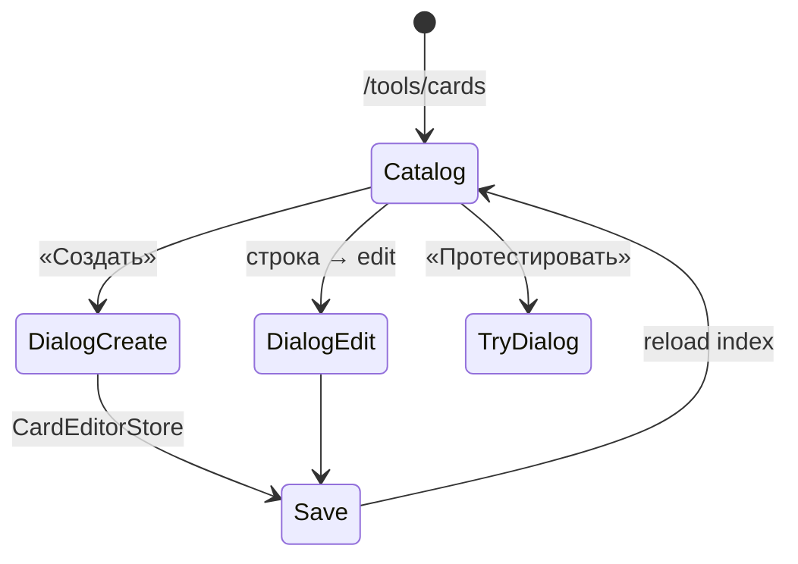

# Архитектура: редактор карточек (`card-editor`)

Каталог карточек + CRUD в dialog. Маршрут `/tools/cards`.

## Назначение

Авторинг и поиск карточек; index + payload; preview и try dialog.

## Структура

```text
features/card-editor/
├── components/
│   ├── card-appearance-fields/        # поля appearance
│   ├── card-create-wizard/            # wizard создания (G12)
│   ├── card-editor-dialog/            # create/edit shell
│   ├── card-editor-discard-dialog/    # подтверждение отправки изменений
│   ├── card-form/                     # shell + kind-forms (G12)
│   ├── card-meta-fields/              # поля индексной метаданных
│   ├── card-options-editor/           # редактор вариантов ответа
│   ├── card-preview/                  # предпросмотр карточки
│   ├── card-try-dialog/               # диалог тестирования карточки
│   └── lexeme-fields/                 # поля для иероглифов/слов
├── services/
│   └── card-editor.store.ts           # стор редактора
├── types/                             # типы фичи
├── utils/
│   ├── draft/                         # черновики
│   ├── form/                          # валидация форм
│   ├── index-meta/                    # индексная метаданные
│   ├── options/                       # варианты ответов
│   ├── tone/                          # тоновые утилиты
│   ├── ux/                            # UX-утилиты
│   └── validation/                    # валидация
└── index.ts                           # barrel-экспорт
```

> **Примечание:** `card-editor-page` — это страница (page), а не компонент фичи. Она расположена в `pages/card-editor/card-editor-page/` и является точкой входа маршрута `/tools/cards`. Компоненты фичи (`features/card-editor/components/`) импортируются страницей.

## Поток CRUD



## Особенности (G12)

- Режимы **Базовый / Расширенный** в dialog.
- Kind-forms: choice, input, pairs, media.
- Bilingual fields + `PhoneticLexeme` (G9/G10).
- Index meta синхронизируется при save (`CardIndexEntry`).

## Зависимости

- `features/card-catalog-search/` — `CardCatalogSearchStore`
- `entities/card/` — `CardSearchService`, `CardRepository`
- `entities/chinese/ui/` — `LexemeDisplayComponent`, `PinyinKeyboardComponent` (для preview)

## Связанные документы

- [CARD-CATALOG.md](./COMMON/CARD-CATALOG.md) · [EDITOR-UX.md](./FEATURES/EDITOR-UX.md) · [CJK-CONTENT.md](./CONTENT/CJK-CONTENT.md)
