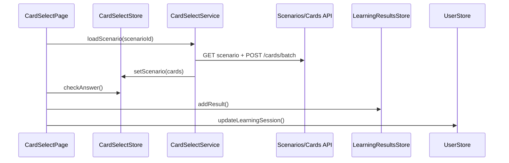

# Архитектура: практика (`card-select`)

Сессия обучения: выбор программы → урока → сценария → прохождение карточек. Маршрут `/cards/select`.

## Назначение

**Студия сессии** (G14): не dashboard, а настройка и прохождение. Dashboard — [ARCHITECTURE.home.md](./ARCHITECTURE.home.md).

## Структура

```text
features/card-select/
├── components/
│   ├── course-picker-section/       # выбор программы (course picker)
│   ├── lesson-picker-section/       # выбор урока (lesson picker)
│   ├── scenario-picker-section/     # выбор сценария (scenario picker)
│   ├── learning-zone/               # зона обучения: карточка + ответ
│   ├── practice-session-bar/        # sticky контекст сессии
│   └── practice-stepper/            # визуализация прогресса по шагам
├── services/
│   ├── card-select.service.ts       # загрузка сценария, batch cards
│   └── card-select.store.ts         # сессия: index, feedback, direction
├── types/                           # типы фичи
├── utils/                           # утилиты фичи
└── index.ts                         # barrel-экспорт
```

> **Примечание:** `card-select-page` — это страница (page), а не компонент фичи. Она расположена в `pages/card-select/card-select-page/` и является точкой входа маршрута `/cards/select`. Компоненты фичи (`features/card-select/components/`) импортируются страницей.

## Поток данных



## UI (G14)

| Элемент         | Компонент                               |
| --------------- | --------------------------------------- |
| Sticky контекст | `app-practice-session-bar`              |
| Шаги            | `app-practice-stepper`                  |
| Вкладки         | Программа / Уроки / Сценарии / Обучение |
| Карточка        | `app-card-host` в centered zone         |

Deep links: `?courseId&lessonId&scenarioId&tab=learning|scenarios|lessons|course&difficulty=beginner|intermediate|advanced`.

### Open practice (opt-in)

Курс может задать `practiceSettings` (`CoursePracticeSettings`):

| Поле                         | По умолчанию | `open` (интервью)                           |
| ---------------------------- | ------------ | ------------------------------------------- |
| `mode`                       | `guided`     | `open`                                      |
| `requireLessonForScenarios`  | `true`       | `false` — сценарии без урока                |
| `enforceLessonPrerequisites` | `true`       | `false` — все уроки кликабельны             |
| `allowDifficultyFilter`      | `false`      | `true` — chips уровня на вкладке «Сценарии» |

Demo/radicals без `practiceSettings` — поведение без изменений. Home/resume остаётся linear.

## Зависимости

- `entities/chinese/ui/`: course-picker, lesson-picker, scenario-picker, card-host, pinyin-keyboard
- `entities/chinese/lib/pinyin/`: утилиты клавиатуры, IPA, romanization
- `entities/`: UserStore, LearningResultsStore, CourseSearchService, CardSelectService

## Связанные документы

- [BUSINESS.md](./BUSINESS.md) · [DOMAIN.md](./COMMON/DOMAIN.md#learning-home-g13) · [SCENARIO-BUILDER.md](./FEATURES/SCENARIO-BUILDER.md)
