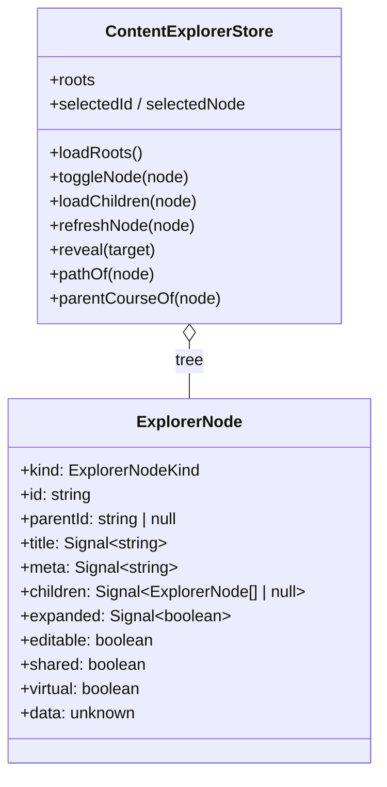

# Архитектура: проводник контента (`content-explorer`)

Единый GUI-проводник, соединяющий всю иерархию `Course → Program → Lesson → Scenario → Card`. Маршрут `/tools/content` (author-зона).

## Назначение

Связывает уровни контента в одном месте: автор видит дерево целиком, создаёт связи «на месте» и переходит в соответствующие билдеры. Реализация «варианта 1» (этапы 1–4, MVP) из плана GUI-связывания; см. [DOMAIN.md](../PRODUCT/DOMAIN.md#иерархия-контента).

## Структура

```text
features/content-explorer/
├── components/
│   ├── explorer-tree/             # левая панель: поиск + список корней (каталоги)
│   ├── explorer-tree-node/        # рекурсивный узел дерева
│   └── explorer-detail/           # правая панель: детали узла (presentational)
├── services/
│   └── content-explorer.store.ts  # стор дерева: ленивая загрузка, selection, reveal
├── types/
│   └── content-explorer.types.ts  # ExplorerNodeKind, ExplorerRevealTarget, filter
└── index.ts                       # barrel

pages/content-explorer/
└── content-explorer-page/         # /tools/content; диалоговая оркестрация (pages → features),
                                    # confirm-диалоги удаления (course/scenario), «Каталог сценариев»
```

## Модель узла



## Сортировка узлов дерева

Единый принцип: **дети любого узла рендерятся в порядке возрастания `<entity>_order`**.
Поле `order` живёт на сущности (или на связи «сценарий → карточка»), а стор
нормализует его в `ExplorerNode.order` и сортирует siblings стабильным
компаратором.

| Уровень    | Колонка в БД         | Поле в API DTO                        | Поле frontend                               | Нормализация                                                          |
| ---------- | -------------------- | ------------------------------------- | ------------------------------------------- | --------------------------------------------------------------------- |
| `course`   | `course_order` (нет) | нет                                   | `Course.order?` / `CourseIndexEntry.order?` | пока не отдаётся бэкендом — корни сохраняют порядок `/courses/search` |
| `program`  | `program_order`      | `order`                               | `Program.order`                             | `normalizeExplorerOrder()`                                            |
| `lesson`   | `lesson_order`       | `lessonOrder`                         | `Lesson.order`                              | `normalizeExplorerOrder()`                                            |
| `scenario` | `scenario_order`     | `order` (+ fallback `scenario_order`) | `Scenario.order?`                           | `normalizeExplicitOrder()`                                            |
| `card`     | `card_order` (связь) | `order` / `resolvedCardIds`           | `Card.order?` / `CardIndexEntry.order?`     | `normalizeExplicitOrder()`                                            |

Правила:

1. **Стабильная сортировка.** Компаратор — `compareExplorerOrder()` в
   `features/content-explorer/types/content-explorer.types.ts`;
   при равных `order` сохраняется исходный порядок (ES2019 stable sort).
2. **`0` — это позиция или «не задано»?** Для `program`/`lesson` — валидная
   позиция. Для `scenario`/`card` контракт задаёт `order >= 1`, поэтому `0` и
   `undefined` трактуются как «не задано»: такие узлы идут **после**
   упорядоченных, сохраняя исходный порядок.
3. **Tie-break (вторичный ключ):**
   - `scenario` — позиция в `lesson.scenarioIds`;
   - `card` — позиция в `cardSource.cardIds` / `Scenario.resolvedCardIds`;
   - `program`/`lesson` — порядок ответа API.
4. **Поиск.** Узлы, добавленные только для поиска (`searchExtraChildren`),
   сортируются тем же компаратором в `visibleChildren`, поэтому режим поиска
   не меняет порядок веток.
5. **Порядок карточек принадлежит связи «сценарий → карточка».** Карточка может
   входить в несколько сценариев (бейдж «shared»), поэтому `card_order` нельзя
   хранить на самой карточке как единственное значение. Источники порядка:
   `scenario_cards.card_order` (целевая схема БД), `Scenario.resolvedCardIds`
   или порядок `cardSource.cardIds`. Для `criteria`-сценариев порядок задаётся
   `criteria.sort`, а не `card_order`.
6. **Обновление после CRUD.** `refreshNode()` обновляет `node.order` из
   перечитанной сущности и вызывает `reorderChildren()`; после reorder
   необходимо сбрасывать кэши (`CourseSearchService.getByIdCache`, индекс
   карточек), иначе порядок не обновится до F5.

## Обновление дерева после CRUD (`refreshNode`)

`refreshNode(node)` — единственная точка синхронизации дерева после сохранения
диалога. Чтобы новый/изменённый узел появлялся **сразу** (а не только после F5),
метод:

1. сбрасывает `CourseSearchService.getById`-кеш — он хранит снимок всего поддерева
   (`programs → lessons → scenarioIds`) и иначе возвращает данные «до сохранения»;
2. перезапрашивает сущность по kind: `course` → `getById`, `program` →
   `ProgramsApiService.getById`, `lesson` → `LessonsApiService.getById`,
   `scenario` → `ScenarioSearchService.getById`;
3. для `program` резолвит уроки через `LessonsApiService.getByProgramId`
   (`/lessons/by-program/:id`), если `GET /programs/:id` вернул пустой/отсутствующий
   `lessons` — иначе вся ветка уроков «исчезала» до F5;
4. синхронизирует снимок родителя (`course.programs` / `program.lessons`) через
   `syncParentSnapshot()`, чтобы collapse/expand не «воскрешал» устаревшие данные;
5. при раскрытом узле перезагружает детей (`loadChildren`).

## Поиск по контенту

Поиск построен поверх того же дерева и использует существующие search-эндпоинты:

1. Совпадения по названиям уже загруженных курсов/треков/уроков/сценариев
   вычисляются локально (`collectTitleMatches`) — без дополнительных запросов.
2. Курсы, треки и сценарии ищутся на бэкенде параллельно с карточками:
   - `/courses/search` — `searchCourseNodes()`; найденные курсы добавляются в `roots`
     (каталог корней ограничен `ROOT_PAGE_SIZE`);
   - `/programs/search` — `searchProgramNodes()`; `ProgramIndexEntry.courseId` даёт
     родительский курс, узел трека добавляется в `searchExtraChildren`;
   - `/scenarios/search` — `searchScenarioNodes()`; `ScenarioIndexEntry.courseId` даёт
     курс, урок резолвится по `lesson.scenarioIds` через `findLessonNodeByScenarioId()`
     (один `getByCourse`), полные сценарии — `getByIdBatch`.
3. `CardIndexEntry` содержит `courseId` / `lessonId` / `scenarioId`; по ним
   `resolveScenarioNodeForCard()` догружает только недостающие узлы-предки
   (курс → трек → урок → сценарий), без полной индексации каталога.
   Быстрые пути используют уже загруженные сценарии (по `scenarioId` или
   `cardSource.cardIds`).
4. `searchVisibleKeys` — совпадения и все их предки; `searchMatchedKeys` — узлы,
   совпавшие сами; `searchAncestorKeys` — контекстные предки (авто-раскрываются
   через `expandAncestors()`); `searchExtraChildren` — узлы, добавленные только для
   поиска (без мутации `children` дерева); `searchResultRoots` — корни результата.
5. `ExplorerTreeNodeComponent`:
   - совпадение (`isSearchMatch`) — обычное интерактивное поведение: кнопка
     разворота видима, при раскрытии рендерятся все дети (флаг `searchSubtree`
     распространяется вниз по поддереву);
   - предок-контекст (`filteredSearchMode`) — раскрыт автоматически, дети
     фильтруются по `searchVisibleKeys`, кнопка разворота скрыта.

Debounce — 300 мс, устаревшие ответы отбрасываются по `searchSequence`,
`clearSearch()` снимает overlay и удаляет поисковые узлы из `nodeIndex`.
Параллельные резолверы делят один in-flight промис загрузки детей
(`pendingChildLoads`), поэтому цепочка предков не наблюдается полузагруженной.

## Ленивая загрузка детей (по существующим ID-ссылкам)

| Родитель   | Источник детей                                                                                                                              | Режим загрузки   |
| ---------- | ------------------------------------------------------------------------------------------------------------------------------------------- | ---------------- |
| `course`   | `CourseSearchService.getById` → `programs` (ProgramWithLessons), сортировка по `program_order`                                              | API              |
| `program`  | `ProgramsApiService.getById` / `data.lessons`, сортировка по `lesson_order`                                                                 | API / кэш        |
| `lesson`   | `lesson.scenarioIds` → `getByIdBatch` + `GET /scenarios/by-lesson/:id`, слияние и сортировка по `scenario_order`                            | API              |
| `scenario` | `criteria` → виртуальный узел «Набор по критериям»; `fixed`/`snapshot` → индекс карточек, сортировка по `card_order` / `cardSource.cardIds` | индекс / virtual |
| `card`     | — (лист, бейдж «shared»)                                                                                                                    | —                |

Новые бэкенд-эндпоинты не требуются. Для `card_order` нужно поле на связи
«сценарий → карточка» (см. раздел [«Сортировка узлов дерева»](#сортировка-узлов-дерева));
до его появления порядок берётся из `cardSource.cardIds` / `Scenario.resolvedCardIds`.

## Связи с существующими билдерами

Редактирование выполняется через существующие диалоги; оркестрация — на странице (FSD: pages → features разрешены, features → features — нет):

| Узел       | Действие                                | Билдер                                                                                    | Обновление дерева                                                       |
| ---------- | --------------------------------------- | ----------------------------------------------------------------------------------------- | ----------------------------------------------------------------------- |
| `course`   | «Редактировать в конструкторе курсов»   | `CourseBuilderDialogService.openEdit(courseId, { forceEdit: true })`                      | `refreshNode(course)`                                                   |
| `course`   | «+ Программа»                           | `ProgramBuilderDialogService.openCreate(courseId)`                                        | `refreshNode(course)`                                                   |
| `course`   | «Удалить» (confirm)                     | `CourseDeleteConfirmDialogComponent` + `CourseBuilderStore.deleteCourse()`                | `clearSelection()`, `loadRoots()`                                       |
| `program`  | «Редактировать в конструкторе программ» | `ProgramBuilderDialogService.openEdit(programId)`                                         | `refreshNode(program)`                                                  |
| `program`  | «Удалить» (confirm)                     | `ProgramDeleteConfirmDialogComponent` + `programsApi.delete()`                            | `refreshNode(course)`, `clearSelection()`                               |
| `lesson`   | «Редактировать в конструкторе курсов»   | `CourseBuilderDialogService.openEdit(parentCourseId)`                                     | `refreshNode(course)`                                                   |
| `lesson`   | «+ Сценарий»                            | `ScenarioBuilderDialogService.openCreate`                                                 | привязка к уроку (PUT курса) + `refreshNode(lesson)`, выбор нового узла |
| `lesson`   | «Удалить» (confirm)                     | `LessonDeleteConfirmDialogComponent` + `lessonsApi.delete()`                              | `refreshNode(program)`, `clearSelection()`                              |
| `scenario` | «Редактировать» / «Добавить карточку»   | `ScenarioBuilderDialogService.openEdit`                                                   | `refreshNode(scenario)`                                                 |
| `scenario` | «Удалить» (только свой, confirm)        | `ScenarioDeleteConfirmDialogComponent` + `ScenarioBuilderStore.deleteScenario(id, entry)` | защитный каскад (PUT курса) + `refreshNode(lesson)`, снятие выделения   |
| `card`     | «Редактировать карточку»                | `CardEditorDialogService.openEdit`                                                        | `refreshNode(parentScenario)`                                           |
| `card`     | «Создать карточку»                      | `CardEditorDialogService.openCreate(kind)`                                                | `refreshNode(parentScenario)`                                           |
| `card`     | «Удалить» (confirm)                     | `CardDeleteConfirmDialogComponent` + `cardEditorStore.deleteCard()`                       | `refreshNode(parentScenario)`, `clearSelection()`                       |

`forceEdit: true` отключает frontend read-only fallback в диалоге курса (курс всегда открывается в режиме «Редактирование курса»); права автора при сохранении по-прежнему проверяет бэкенд.

Backlinks: для карточек — «Где используется» через `ScenarioSearchService.findUsingCard`.

## Сценарии в Проводнике (после миграции из «Конструктора сценариев»)

Страница `/tools/scenario-builder` удалена; маршрут редиректит на `/tools/content` (этапы 1–7 плана [crisp-tiger-plan-scenario.md](../../crisp-tiger-plan-scenario.md)). Управление сценариями — дерево Проводника + «Каталог сценариев»; детали фичи — [ARCHITECTURE.scenario-builder.md](./ARCHITECTURE.scenario-builder.md).

### Привязка сценария к уроку («+ Сценарий» на узле урока)

Диалог сохраняет сценарий и закрывается с `result.scenarioId`
(`ScenarioBuilderStore.createScenario` возвращает созданный `Scenario | null`);
страница выполняет точечное обновление курса:

1. course-узел — через `store.pathOf(lessonNode)`; `courseSearchService.getById(courseId)`;
2. `courseWithProgramsToWritePayload(course)` (`entities/course/utils/`) — маппинг без бизнес-валидаций `normalizeDraft`;
3. `appendScenarioToLessonPayload(payload, lessonId, scenarioId)` — append с dedupe, порядок сохраняется;
4. `courseSearchService.update(courseId, payload)` (PUT `/courses/{id}`) + `clearGetByIdCache()`;
5. `store.refreshNode(lessonNode)` (узел раскрывается) + выбор нового scenario-узла.

Ошибка привязки некритична: сценарий уже создан — snackbar «Сценарий создан,
но не удалось привязать его к уроку…», без отката. Привязка выполняется только
для `kind === 'lesson'`, `editable` и не-virtual узлов. `LessonUpdateRequest`
не содержит `scenarioIds` — единственный путь записи привязки это PUT курса
целиком (future improvement — сгенерированный API).

### Удаление сценария («Удалить» в detail-панели)

- Кнопка видна только при `canEditOwnScenario()` — владение проверяется по
  данным узла (`isEditableContentAuthor`); чужие сценарии удалить нельзя.
- Подтверждение обязательное: `scenario-delete-confirm-dialog.component.ts`
  (pages-слой Проводника, по образцу course-delete-confirm-dialog).
- После подтверждения — `ScenarioBuilderStore.deleteScenario(node.id, entry)`
  (владение в store проверяется по `entry` из данных узла, fallback — список и
  `getById`, fail-safe), затем защитный каскад: `removeScenarioFromLessonPayload`
  - PUT курса (идемпотентно — если бэкенд уже убрал id из `lesson.scenarioIds`),
    `store.refreshNode(lesson)`, снятие выделения.

### Бейдж «Опубликован» / «Черновик»

Detail-панель для scenario-узлов показывает статус из `node.data.published`
(чип согласован с meta-строкой дерева).

### «Каталог сценариев» (header)

Inline-панель в header страницы; переиспользует `ScenarioBuilderStore`
(root-синглтон): scope-тумблер «Мои / Опубликованные / Все» (`setListScope` —
сброс на страницу 0), пагинация (`UiPaginationComponent`, `setPage`),
«Создать сценарий» (`openCreate` без привязки) и «Редактировать» (`openEdit`,
чужие — read-only; дерево не меняется). Список перезагружается при открытии
панели. Поиска и фильтра-чипов по курсам нет (осознанное упрощение); сценарии
урока в дереве грузятся по `lesson.scenarioIds` без пагинации — осознанное
ограничение.

## Deep links

```text
/tools/content?courseId&programId&lessonId&scenarioId&cardId
```

`ContentExplorerStore.reveal()` раскрывает цепочку и выбирает самый глубокий узел; при разрыве цепочки — `found: false` без ошибки.

## Права и терминология

- Маршрут за `authorGuard` — только `ROLE_AUTHOR` / `ROLE_ADMIN` (см. [roles-zones](./ARCHITECTURE.roles-zones.md)).
- `editable` узла — по `isEditableContentAuthor`; read-only узлы помечены 🔒 (диалоги дополнительно применяют свои правила).
- Терминология UI — по [DOMAIN.md](../PRODUCT/DOMAIN.md#термины-не-путать-курс-course-и-program): `Course` — «Каталог программ», `Program` — «Трек».

## Бэклог (следующие этапы)

- Drag-and-drop: reorder внутри родителя (`order`, `lessonIds`, `scenarioIds`, `cardIds`), перенос карточек между сценариями с `mode: fixed` (CDK DragDrop).
- Inline-редактирование в detail-панели (вместо модальных диалогов) с переиспользованием form-секций `course-form`.
- Фильтрация корней по языковым парам пользователя.

## Связанные документы

- [DOMAIN.md](../PRODUCT/DOMAIN.md) · [ARCHITECTURE.course.md](./ARCHITECTURE.course.md) · [ARCHITECTURE.program.md](./ARCHITECTURE.program.md) · [ARCHITECTURE.scenario-builder.md](./ARCHITECTURE.scenario-builder.md) · [ARCHITECTURE.card-editor.md](./ARCHITECTURE.card-editor.md)
