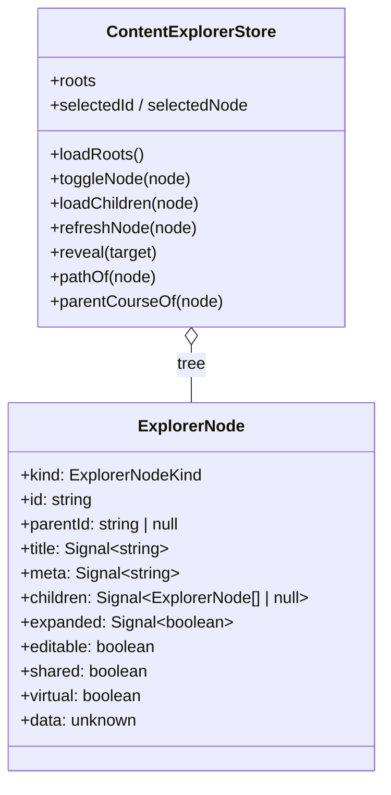

# Архитектура: проводник контента (`content-explorer`)

Единый GUI-проводник, соединяющий всю иерархию `Course → Program → Lesson → Scenario → Card`. Маршрут `/tools/content` (author-зона).

## Назначение

Связывает уровни контента в одном месте: автор видит дерево целиком, создаёт связи «на месте» и переходит в соответствующие билдеры. Реализация «варианта 1» (этапы 1–4, MVP) из плана GUI-связывания; см. [DOMAIN.md](../PRODUCT/DOMAIN.md#иерархия-контента).

## Структура

```text
features/content-explorer/
├── components/
│   ├── explorer-tree/             # левая панель: поиск + список корней (каталоги)
│   ├── explorer-tree-node/        # рекурсивный узел дерева
│   └── explorer-detail/           # правая панель: детали узла (presentational)
├── services/
│   └── content-explorer.store.ts  # стор дерева: ленивая загрузка, selection, reveal
├── types/
│   └── content-explorer.types.ts  # ExplorerNodeKind, ExplorerRevealTarget, filter
└── index.ts                       # barrel

pages/content-explorer/
└── content-explorer-page/         # /tools/content; диалоговая оркестрация (pages → features)
```

## Модель узла



## Ленивая загрузка детей (по существующим ID-ссылкам)

| Родитель | Источник детей | Режим загрузки |
| -------- | -------------- | -------------- |
| `course`  | `CourseSearchService.getById` → `programs` (ProgramWithLessons) | API |
| `program` | `ProgramsApiService.getById` / `data.lessons` | API / кэш |
| `lesson`  | `lesson.scenarioIds` → `ScenarioSearchService.getByIdBatch` | API |
| `scenario` | `cardSource.mode === 'criteria'` → виртуальный узел «Набор по критериям»; `fixed`/`snapshot` → индекс карточек (`CardSearchService`) | индекс / virtual |
| `card` | — (лист, бейдж «shared») | — |

Новые бэкенд-эндпоинты не требуются.

## Связи с существующими билдерами

Редактирование выполняется через существующие диалоги; оркестрация — на странице (FSD: pages → features разрешены, features → features — нет):

| Узел | Действие | Билдер | Обновление дерева |
| ---- | -------- | ------ | ----------------- |
| `course` | «Редактировать в конструкторе курсов» | `CourseBuilderDialogService.openEdit(courseId, { forceEdit: true })` | `refreshNode(course)` |
| `course` | «+ Программа» | `ProgramBuilderDialogService.openCreate(courseId)` | `refreshNode(course)` |
| `program` | «Редактировать в конструкторе программ» | `ProgramBuilderDialogService.openEdit(programId)` | `refreshNode(program)` |
| `lesson` | «Редактировать в конструкторе курсов» | `CourseBuilderDialogService.openEdit(parentCourseId)` | `refreshNode(course)` |
| `lesson` | «+ Сценарий» | `ScenarioBuilderDialogService.openCreate` | snackbar-подсказка (связь — в course-builder) |
| `scenario` | «Редактировать» / «Добавить карточку» | `ScenarioBuilderDialogService.openEdit` | `refreshNode(scenario)` |
| `card` | «Редактировать карточку» | `CardEditorDialogService.openEdit` | `refreshNode(parentScenario)` |

`forceEdit: true` отключает frontend read-only fallback в диалоге курса (курс всегда открывается в режиме «Редактирование курса»); права автора при сохранении по-прежнему проверяет бэкенд.

Backlinks: для карточек — «Где используется» через `ScenarioSearchService.findUsingCard`.

## Deep links

```text
/tools/content?courseId&programId&lessonId&scenarioId&cardId
```

`ContentExplorerStore.reveal()` раскрывает цепочку и выбирает самый глубокий узел; при разрыве цепочки — `found: false` без ошибки.

## Права и терминология

- Маршрут за `authorGuard` — только `ROLE_AUTHOR` / `ROLE_ADMIN` (см. [roles-zones](./ARCHITECTURE.roles-zones.md)).
- `editable` узла — по `isEditableContentAuthor`; read-only узлы помечены 🔒 (диалоги дополнительно применяют свои правила).
- Терминология UI — по [DOMAIN.md](../PRODUCT/DOMAIN.md#термины-не-путать-курс-course-и-program): `Course` — «Каталог программ», `Program` — «Трек».

## Бэклог (следующие этапы)

- Drag-and-drop: reorder внутри родителя (`order`, `lessonIds`, `scenarioIds`, `cardIds`), перенос карточек между сценариями с `mode: fixed` (CDK DragDrop).
- Inline-редактирование в detail-панели (вместо модальных диалогов) с переиспользованием form-секций `course-form`.
- Фильтрация корней по языковым парам пользователя.

## Связанные документы

- [DOMAIN.md](../PRODUCT/DOMAIN.md) · [ARCHITECTURE.course.md](./ARCHITECTURE.course.md) · [ARCHITECTURE.program.md](./ARCHITECTURE.program.md) · [ARCHITECTURE.scenario-builder.md](./ARCHITECTURE.scenario-builder.md) · [ARCHITECTURE.card-editor.md](./ARCHITECTURE.card-editor.md)
