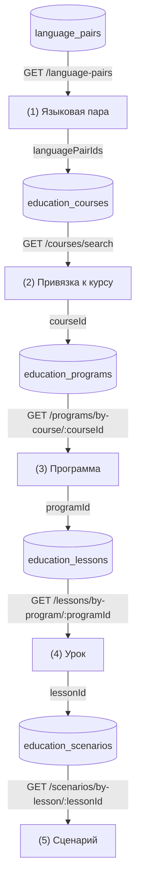

# Архитектура: каскад иерархии контента

Единый контракт для полей «Языковая пара → Привязка к курсу → Программа → Урок → Сценарий» в диалогах авторинга.

## Принцип

> Опции каскадных комбо всегда загружаются из таблиц бэкенда через API.
> Статические массивы опций допустимы только в mock-слое (`entities/*/api/mock/**`) и fixture-файлах `public/data/**`.
> `DEFAULT_*` — это fallback нормализации, а не источник вариантов.

Диалоги, на которые распространяется правило:

| Диалог                                         | Уровни              |
| ---------------------------------------------- | ------------------- |
| `Редактирование Курса`                         | (1)                 |
| `Редактирование программы`                     | (1) (2)             |
| `Редактирование урока`                         | (1) (2) (3)         |
| `Новый сценарий`                               | (1) (2) (3) (4)     |
| `Новая карточка` (`CardEditorDialogComponent`) | (1) (2) (3) (4) (5) |

## Источники данных

| Поле                 | Таблица               | Эндпоинт                              | Метод фронтенда                         | Фильтр                               |
| -------------------- | --------------------- | ------------------------------------- | --------------------------------------- | ------------------------------------ |
| (1) Языковая пара    | `language_pairs`      | `GET /language-pairs`                 | `LanguagePairsApiService.listAll()`     | —                                    |
| (2) Привязка к курсу | `education_courses`   | `GET /courses/search`                 | `CourseSearchService.search()`          | `languagePairIds: [pairId]`, `scope` |
| (3) Программа        | `education_programs`  | `GET /programs/by-course/{courseId}`  | `ProgramsApiService.getByCourse()`      | `courseId`                           |
| (4) Урок             | `education_lessons`   | `GET /lessons/by-program/{programId}` | `LessonsApiService.getByProgramId()`    | `programId`                          |
| (5) Сценарий         | `education_scenarios` | `GET /scenarios/by-lesson/{lessonId}` | `ScenarioSearchService.getByLessonId()` | `lessonId`                           |

Названия языковых пар форматируются по словарю `/languages` (`LanguageService.getLabels()`), а не по фронтенд-константам.

## Каскад

Правила:

1. **Вниз — сброс.** Смена верхнего уровня обнуляет все нижние значения и перезагружает непосредственный дочерний список.
2. **Вверх — гидратация.** Если диалог открыт с `courseId`/`programId`/`lessonId`/`scenarioId`, сервис восстанавливает предков по ID, чтобы селекты были заполнены названиями.
3. **Конфликт «пара vs предок».** В `edit` побеждает предок (пара выставляется из него), в `create` побеждает выбранная пара (несовместимый курс сбрасывается).
4. **Read-only уровни.** Пара в карточке не редактируется: она выводится из языков содержимого и используется только для фильтрации курсов.
5. **Нижние селекты disabled**, пока не выбран родитель.
6. **Гонки.** Каждый уровень имеет номер запроса; применяется только последний ответ.

## Компонент и сервис

Слайс: `src/app/entities/content-hierarchy/`.

| Элемент                             | Назначение                                                              |
| ----------------------------------- | ----------------------------------------------------------------------- |
| `ContentHierarchyService`           | Загрузка, кэш по родительскому ID, гидратация, инвалидация              |
| `ContentHierarchySelectorComponent` | Один составной виджет на 1–5 уровней, `levels`/`value`/`readOnlyLevels` |
| `HierarchyValue`                    | `{ languagePairId?, courseId?, programId?, lessonId?, scenarioId? }`    |

Почему один виджет, а не пять:

- каскад — единый автомат; раздельные smart-виджеты дублируют загрузку, сброс и защиту от гонок;
- пять фич-потребителей получают один контракт и одинаковое поведение;
- `levels` покрывает разный состав полей в диалогах;
- внутренние презентационные селекты можно выделить позже без изменения публичного API.

### FSD

Слайс размещён в `entities/`, потому что его используют пять фич (`course-builder`, `program-builder`, `lesson-builder`, `scenario-builder`, `card-editor`). Правила проекта запрещают `features → widgets` и cross-feature импорты, а `shared` не может импортировать сущности. UI в `entities` уже используется для pickers.

`ContentHierarchyService` предоставляется на уровне диалога (`providers: [ContentHierarchyService]`), чтобы кэш был свежим при каждом открытии. Виджет внедряет сервис опционально — изолированные тесты форм могут рендерить его без HTTP.

## Анти-паттерны

- `scope: 'all'` без `languagePairIds` для курсов.
- `course.programs`, `program.lessons`, `lesson.scenarioIds` как источник опций вместо табличных эндпоинтов.
- `title: id` для сценариев.
- Статические массивы курсов/программ/уроков/сценариев в production-коде.
- Загрузка дочерних списков в `ngOnInit` без реакции на смену родителя.

## Тесты

- `content-hierarchy.service.spec.ts` — загрузка, кэш, гидратация, инвалидация.
- `content-hierarchy-selector.component.spec.ts` — каскад, сброс нижних уровней, read-only, гидратация.
- `card-form-placement-tab.component.spec.ts` — контракт вкладки «Размещение».
