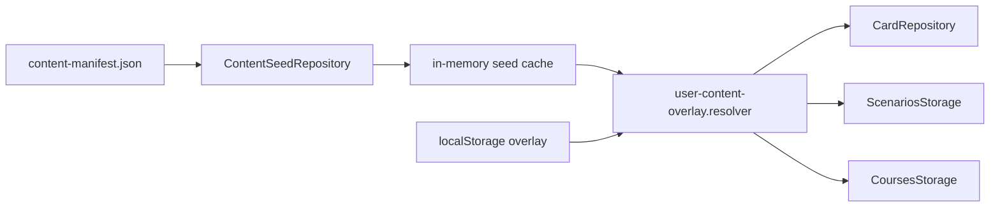
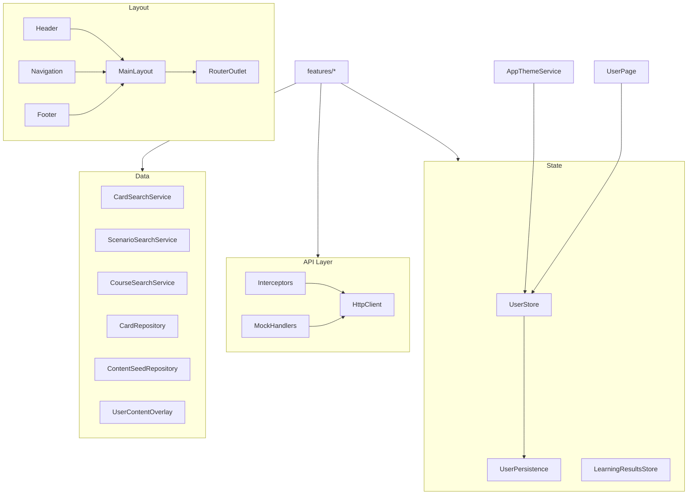

# Архитектура: бывший `core` (миграция завершена)

> **Статус: удалён.** Слой `src/app/core/` **полностью удалён** — shim-баррели больше не нужны, потребители импортируют напрямую из `entities/*/`, `shared/`, `widgets/`, `app/`. Этот документ описывает, куда переехала бывшая функциональность `core/`.

Оглавление: [INDEX.md](./INDEX.md) · обзор: [ARCHITECTURE.md](./ARCHITECTURE.md).

## Куда переехал `core/`

| Бывший путь (`core/`)            | Новое расположение                                        |
| -------------------------------- | --------------------------------------------------------- |
| `core/models`                    | `entities/*/model` (card, scenario, course, learning, phonetic, user, language-pair) |
| `core/domain`                    | `entities/*/lib` (chinese, ipa, phonetic, language-pair, learning, journey, lesson, code-highlight, keyboard-answer-mode, user) |
| `core/repositories`              | `entities/*/` (card, course, scenario, user, content-seed) |
| `core/state`                     | `entities/*/model` (`user.store`, `user.persistence`, `learning-results.store`, `learning-results.persistence`) + `shared/types/async-state.types` |
| `core/api`                       | `entities/*/api` + `app/api` (clients, interceptors, errors, `provide-api.http`) |
| `core/layout`                    | `widgets/` (header, footer, main-layout, navigation, menu-\*) + `pages/` (user, help, help-usage-scenarios) |
| `core/security`                  | `shared/security`                                          |
| `core/theme`                     | `app/theme` + `shared/theme` + `entities/user/lib`         |
| `core/hanzi-engine`              | `entities/chinese/lib` (drawing, validation, quiz, rendering) |
| `core/services`                  | `entities/journey/lib/journey-analytics.service`           |

## Состояние

| Store                  | Ключ persistence               | Назначение                                                                 |
| ---------------------- | ------------------------------ | -------------------------------------------------------------------------- |
| `UserStore`            | `lingua-code.user`             | Пользователь, `UserPreferences`, `learningProficiencyLevel`, языковые пары |
| `LearningResultsStore` | `lingua-code.learning-results` | Ответы, прогресс по сценариям/урокам/программам                            |
| User content overlay   | `lingua-code.user-content.v1`  | Пользовательские правки courses / lessons / scenarios / cards поверх seed  |

## Content seed + overlay

Системный контент загружается один раз через **`ContentSeedRepository`** по манифесту `public/data/content-manifest.json` (списки JSON для карточек, сценариев, программ). Кэш в памяти — `content-seed.cache.ts`.

Пользовательские изменения (CRUD в редакторах) сохраняются в **`UserContentOverlay`** (`user-content-overlay.storage.ts`). При чтении каталога seed **мерджится** с overlay (`user-content-overlay.resolver.ts`); удаления системных сущностей — через `deletedSystemIds`.

Миграция при первом запуске: legacy ключи `lingua-code.cards`, `lingua-code.scenarios`, `lingua-code.course-catalog`, `lingua-code.card-index-meta` → единый overlay (`user-content-overlay.migration.ts`).

### Экспорт пользовательского курса в seed

**`npm run export:content-seed`** — регенерация demo/radicals/perl seed из скриптов (`scripts/export-content-seed.mjs`). Не экспортирует пользовательские курсы.

**`CourseBundle`** — формат для переноса пользовательского курса из localStorage в seed репозитория:

- **Экспорт из UI**: кнопка «Экспорт файла» в Конструкторе курсов → скачивание `.linguacode-course.json`.
- **Импорт в репозиторий**: `npm run import:course-bundle -- --bundle <file> --slug <slug>`.
- **Модуль сбора**: `src/app/entities/course/utils/course-bundle.utils.ts` — `collectCourseBundle()` обходит граф Course → Lesson → Scenario → Card.
- **Документация**: [COURSE-BUNDLE.md](./FEATURES/COURSE-BUNDLE.md).



## API (mock + HTTP)

- Interceptors: auth, error, mock для cards/scenarios/courses в dev (`app/api/interceptors`, `entities/*/api/mock`).
- Search-сервисы: `CardSearchService`, `ScenarioSearchService`, `CourseSearchService` в `entities/{card,course,scenario}/search/`.

## Диаграмма компонентов (UML)



## Особенности

- **Signals** — основной API состояния; RxJS только на границе HTTP.
- **Standalone** — без NgModule.
- **Lazy routes** — фичи не загружаются в общий слой.
- **Theme** — `colorScheme` из `UserStore` → классы `theme-light` / `theme-dark` на `<html>`.

## Связанные пути (overlay + seed + bundle)

```
src/app/entities/content-seed/content-seed.repository.ts
src/app/entities/content-seed/content-seed.cache.ts
src/app/entities/user/overlay/user-content-overlay.types.ts
src/app/entities/user/overlay/user-content-overlay.storage.ts
src/app/entities/user/overlay/user-content-overlay.resolver.ts
src/app/entities/user/overlay/user-content-overlay.migration.ts
src/app/entities/course/utils/course-bundle.types.ts
src/app/entities/course/utils/course-bundle.utils.ts
public/data/content-manifest.json
scripts/export-content-seed.mjs
scripts/import-course-bundle.mjs
docs/FEATURES/COURSE-BUNDLE.md
```

## Связанные документы

- [DOMAIN.md](./SYSTEM/DOMAIN.md#модели) · [ARCHITECTURE.md](./ARCHITECTURE.md) · [LANGUAGE-PAIR.md](./FEATURES/LANGUAGE-PAIR.md)
