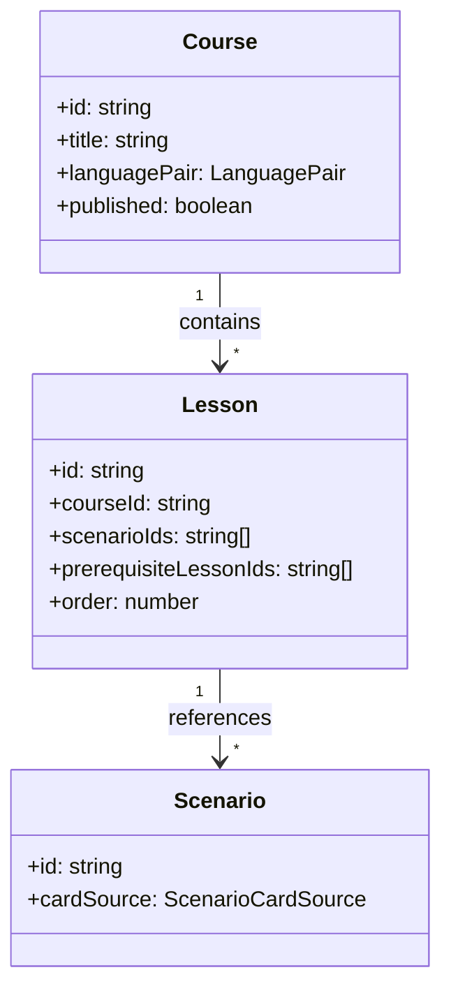

# Архитектура: программы (`course-builder`, `course-catalog`)

Учебные программы (`Course`) и уроки (`Lesson`). Маршруты `/tools/courses`, `/courses`.

## Назначение

- **course-builder** — CRUD программ и уроков для авторов.
- **course-catalog** — каталог опубликованных программ для выбора в практике.

## Структура

```text
features/course-builder/     # /tools/courses
├── components/
│   ├── course-builder-dialog/    # dialog создания/редактирования программы
│   ├── course-form/              # форма программы
│   └── reset-overlay-dialog/     # диалог сброса оверлея
├── services/
├── types/
├── utils/
├── models/
└── index.ts

features/course-catalog/     # /courses (published)
├── components/
│   ├── course-card-list/       # список карточек программ
│   ├── course-settings/        # настройки программы
│   └── program-list/           # список программ
├── services/
├── utils/
├── models/
└── index.ts

entities/course/search/          # поиск по курсам
entities/course/model/           # типы курсов и уроков
```

> **Примечание:** `course-builder-page` и `course-catalog-page` — это страницы (pages), а не компоненты фичй. Они расположены в `pages/course-builder/` и `pages/course-catalog/` соответственно и являются точками входа маршрутов `/tools/courses` и `/courses`.

## Иерархия



## Прогресс

- `LearningResult.courseId`, `lessonId` — агрегация в `LearningResultsStore`.
- Prerequisites уроков — `lesson-prerequisites.utils`.

## Связанные документы

- [DOMAIN.md](./COMMON/DOMAIN.md#иерархия-контента) · [ARCHITECTURE.home.md](./ARCHITECTURE.home.md)
