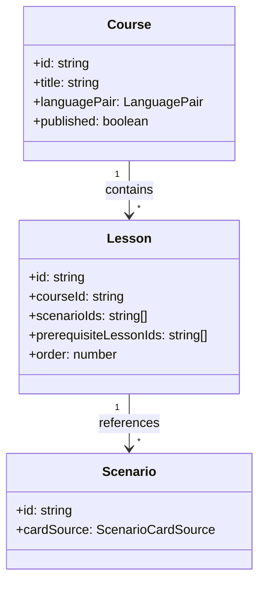

# Архитектура: курсы (`course-builder`, `course-catalog`, `program-builder`)

Курсы (`Course`), программы (`Program`) и уроки (`Lesson`). Маршруты `/tools/courses`, `/courses`.

## Назначение

- **course-builder** — CRUD курсов для авторов: создание, редактирование, просмотр, экспорт.
- **program-builder** — CRUD программ (учебных треков) внутри курса: создание, редактирование, удаление.
- **course-catalog** — каталог опубликованных курсов для выбора в практике.

## Структура

```text
features/course-builder/     # /tools/courses
├── components/
│   ├── course-builder-dialog/    # dialog создания/редактирования курса
│   ├── course-form/              # форма курса
│   └── reset-overlay-dialog/     # диалог сброса оверлея
├── services/
├── types/
├── utils/
├── models/
└── index.ts

features/program-builder/    # /tools/courses (вложенный редактор программ)
├── components/
│   ├── program-form/               # форма программы (title, requiredTier, description, published)
│   └── program-builder-dialog/     # dialog CRUD программ
├── services/
│   └── program-builder.store.ts
├── types/
├── utils/
└── index.ts

features/course-catalog/     # /courses (published)
├── components/
│   ├── course-card-list/       # список карточек программ
│   ├── course-settings/        # настройки программы
│   └── program-list/           # список программ
├── services/
├── utils/
├── models/
└── index.ts

entities/course/search/          # поиск по курсам
entities/course/model/           # типы курсов и уроков
entities/program/                # сущность Program (модели, API, репозиторий, поиск)
```

> **Примечание:** `course-builder-page` и `course-catalog-page` — это страницы (pages), а не компоненты фичй. Они расположены в `pages/course-builder/` и `pages/course-catalog/` соответственно и являются точками входа маршрутов `/tools/courses` и `/courses`.

## Иерархия



## Форма курса (`CourseFormComponent`)

Диалог «Редактирование курса» использует `mat-tab-group` с **4 вкладками**:

| Вкладка | Содержание |
|---------|-----------|
| **Основное** | Название каталога, описание, статус авторства, published |
| **Практика** | Режим навигации, requireLessonForScenarios, enforceLessonPrerequisites, allowDifficultyFilter |
| **Идея каталога** | Markdown-поле для описания идеи (authoring.idea) |
| **Экспорт** | PDF (без подсказок / с ответами), JSON (CourseBundle), SCORM/xAPI |

Экспорт вынесен на отдельную вкладку — это операции, а не редактирование данных, поэтому они не влияют на dirty-state формы.

Кнопки экспорта используют горизонтальное расположение: иконка слева, текст справа (`flex-direction: row`).

## Форма программы (`ProgramFormComponent`)

Диалог «Редактирование программы» содержит **4 поля**:

| Поле              | UI-контроль       | Описание                                    |
| ----------------- | ----------------- | ------------------------------------------- |
| `title`           | `mat-input`       | Название (1–200 символов)                   |
| `requiredTier`    | `mat-select`      | Уровень доступа: `FREE`, `STARTER`, `GROWTH`, `PREMIUM` |
| `description`     | `mat-textarea`    | Описание для каталога                       |
| `published`       | `mat-checkbox`    | Опубликовать (только edit mode)             |

- `requiredTier` — обязательное поле, дефолт `FREE`.
- `languagePairId` — не отображается в форме, извлекается из `Course` при создании.
- `lessonIds` — не редактируется в диалоге (управляется через lesson-builder).
- Dirty-state отслеживается через сравнение draft с initial программой.

## Прогресс

- `LearningResult.courseId`, `lessonId` — агрегация в `LearningResultsStore`.
- Prerequisites уроков — `lesson-prerequisites.utils`.

## Связанные документы

- [DOMAIN.md](../PRODUCT/DOMAIN.md#иерархия-контента) · [ARCHITECTURE.home.md](./ARCHITECTURE.home.md)
