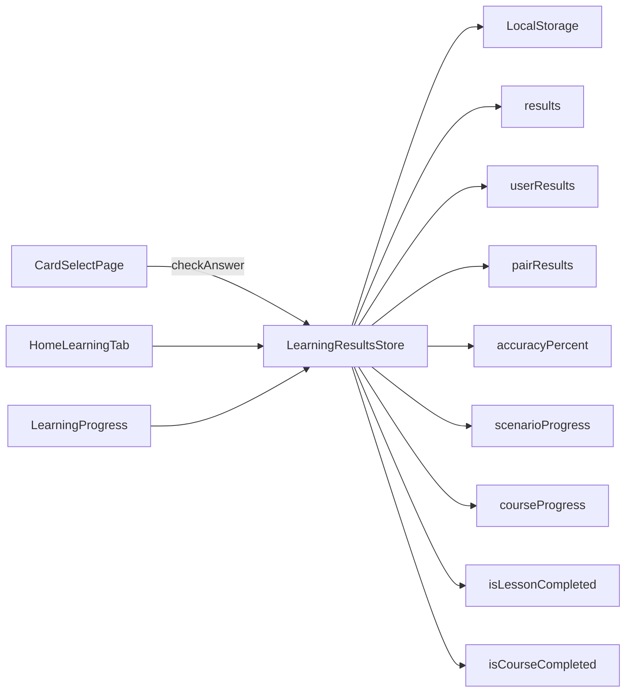

# Архитектура: результаты обучения (`learning-results`)

Сохранение ответов и отображение статистики. Маршрут `/home/progress`.

## Назначение

Фиксация `LearningResult` при каждом ответе; агрегация прогресса по сценарию, уроку, программе.

## Структура

```text
entities/learning/model/
├── learning-result.types.ts    # типы результатов обучения
├── learning-results.store.ts   # стор результатов (signal-based)
├── learning-results.persistence.ts  # персистентность в localStorage
├── journey.types.ts            # типы джорнея
├── learning-proficiency.types.ts  # типы профайшенса
├── learning-session.types.ts   # типы сессии обучения
└── index.ts                    # barrel-экспорт

entities/learning/lib/
├── learning-proficiency.utils.ts  # утилиты профайшенса
├── learning-resume.utils.ts       # утилиты продолжения обучения
├── learning-session.utils.ts      # утилиты сессии
└── index.ts                       # barrel-экспорт
```

> **Примечание:** Страница прогресса находится в `pages/home/` (вкладка `/home/progress`) или в `pages/journey/journey-page/`, а не в отдельной папке `learning-results`.

## Модель

```typescript
type LearningResult = {
  id: string;
  userId: string;
  cardId: string;
  scenarioId: string;
  correct: boolean;
  answeredAt: string; // ISO 8601
  languagePair: LanguagePair;
  direction?: CardDirection;
  programId?: string; // G17 — опционально для агрегации прогресса по треку
  lessonId?: string; // G11 — опционально для агрегации прогресса по уроку
  courseId?: string; // G11 — опционально для агрегации прогресса по каталогу
};
```

## Диаграмма



## API store (ключевые методы)

| Метод                 | Назначение                                |
| --------------------- | ----------------------------------------- |
| `addResult`           | Запись ответа                             |
| `resultsForScenario`  | История по сценарию                       |
| `scenarioSetProgress` | completed/total по списку scenarioIds     |
| `lessonProgress`      | прогресс урока (lessonId + stats)         |
| `courseProgress`      | % по программе                            |
| `isLessonCompleted`   | все сценарии урока пройдены               |
| `isCourseCompleted`   | все сценарии курса пройдены               |
| `completedCourseIds`  | IDs завершённых курсов                    |
| `hasResultsForCard`   | есть ли результаты по карточке            |
| `clear`               | очистка результатов текущего пользователя |

## Computed-сигналы

| Сигнал             | Тип данных                            |
| ------------------ | ------------------------------------- |
| `results`          | `readonly LearningResult[]`           |
| `userResults`      | результаты текущего пользователя      |
| `pairResults`      | результаты для активной языковой пары |
| `totalCount`       | общее количество ответов              |
| `correctCount`     | количество правильных ответов         |
| `accuracyPercent`  | процент точности (0–100)              |
| `recentResults`    | последние 10 результатов (сортировка) |
| `scenarioProgress` | агрегация по scenarioId               |

## Связанные документы

- [DOMAIN.md](../PRODUCT/DOMAIN.md#модели) · [ARCHITECTURE.home.md](./ARCHITECTURE.home.md)
