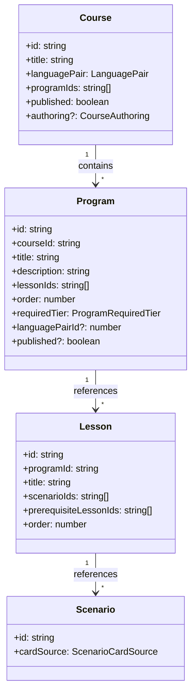

# Архитектура: учебные треки (`Program`)

Учебные треки (`Program`) — уровень между `Course` и `Lesson`. Маршруты `/tools/courses` (вложенный редактор программ).

## Назначение

- **`Program`** — учебный трек / модуль внутри `Course`. Содержит упорядоченный список уроков (`lessonIds`).
- **`Course`** — каталог программ: `LanguagePair`, `published`, `authoring`. Не содержит уроков напрямую.

## Иерархия

```text
Course → Program → Lesson → Scenario → Card
```



## Структура

```text
entities/program/
├── model/            # типы программ (program.types.ts, program-ids.ts)
├── repository/       # ProgramCatalogPort
├── api/              # ProgramsApiService, mock handlers
├── search/           # ProgramSearchService
├── ui/               # program-picker, program-list
└── index.ts          # barrel export

features/program-builder/
├── components/
│   ├── program-form/           # форма программы
│   └── program-builder-dialog/ # dialog CRUD
├── services/
│   └── program-builder.store.ts
├── types/
└── index.ts
```

## Прогресс

- `LearningResult.programId` — агрегация в `LearningResultsStore`.
- `LearningSessionPreferences.activeProgramId?` — сохранение текущего трека.
- `LearningDashboardService` — загрузка программы, roadmap уроков, resume target.

## Отличие от Course

| Свойство       | `Course`            | `Program`                                                             |
| -------------- | ------------------- | --------------------------------------------------------------------- |
| Роль           | Каталог / категория | Учебный трек / модуль                                                 |
| `LanguagePair` | Да (scope контента) | Нет (наследуется от Course, передаётся `languagePairId` при создании) |
| `published`    | Да                  | Да (опционально, только обновление)                                   |
| `authoring`    | Да (G16)            | Нет                                                                   |
| `requiredTier` | Нет                 | Да (`FREE` / `STARTER` / `GROWTH` / `PREMIUM`)                        |
| Содержит       | `programIds`        | `lessonIds`                                                           |
| UI-название    | «Каталог программ»  | «Трек» / «Модуль»                                                     |

## Поля `Program`

| Поле                 | Create   | Update   | Описание                                                |
| -------------------- | -------- | -------- | ------------------------------------------------------- |
| `title`              | required | optional | Название (1–200 символов)                               |
| `programDescription` | optional | optional | Описание для каталога                                   |
| `courseId`           | required | —        | ID родительского курса (BIGINT)                         |
| `requiredTier`       | required | required | Уровень доступа: `FREE`, `STARTER`, `GROWTH`, `PREMIUM` |
| `order`              | optional | optional | Порядок в курсе (по умолчанию 0)                        |
| `languagePairId`     | optional | optional | Пара языков (извлекается из курса)                      |
| `published`          | —        | optional | Опубликовать (только update)                            |
| `authorId`           | —        | —        | Автоматически из токена (бэкенд)                        |
| `lessonIds`          | —        | —        | Пустой массив при create (lesson-builder)               |
| `createdAt`          | —        | —        | Авто (бэкенд)                                           |
| `updatedAt`          | —        | —        | Авто (бэкенд)                                           |

> **`languagePairId`** — фронтенд извлекает из `Course` при создании программы через `CourseSearchService.getById()`. Бэкенд не требует это поле (`@NotNull` отсутствует), но передача улучшает связность данных.

## Связанные документы

- [DOMAIN.md](../PRODUCT/DOMAIN.md#иерархия-контента) · [ARCHITECTURE.md](../PRODUCT/ARCHITECTURE.md) · [TASKS.md](../TASKS.md)
