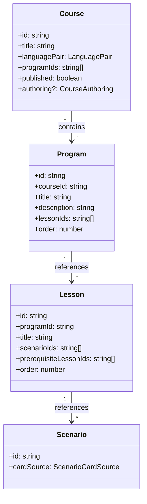

# Архитектура: учебные треки (`Program`)

Учебные треки (`Program`) — уровень между `Course` и `Lesson`. Маршруты `/tools/courses` (вложенный редактор программ).

## Назначение

- **`Program`** — учебный трек / модуль внутри `Course`. Содержит упорядоченный список уроков (`lessonIds`).
- **`Course`** — каталог программ: `LanguagePair`, `published`, `authoring`. Не содержит уроков напрямую.

## Иерархия

```text
Course → Program → Lesson → Scenario → Card
```



## Структура

```text
entities/program/
├── model/            # типы программ (program.types.ts, program-ids.ts)
├── repository/       # ProgramCatalogPort
├── api/              # ProgramsApiService, mock handlers
├── search/           # ProgramSearchService
├── ui/               # program-picker, program-list
└── index.ts          # barrel export

features/program-builder/
├── components/
│   ├── program-form/           # форма программы
│   └── program-builder-dialog/ # dialog CRUD
├── services/
│   └── program-builder.store.ts
├── types/
└── index.ts
```

## Прогресс

- `LearningResult.programId` — агрегация в `LearningResultsStore`.
- `LearningSessionPreferences.activeProgramId?` — сохранение текущего трека.
- `LearningDashboardService` — загрузка программы, roadmap уроков, resume target.

## Отличие от Course

| Свойство       | `Course`            | `Program`                   |
| -------------- | ------------------- | --------------------------- |
| Роль           | Каталог / категория | Учебный трек / модуль       |
| `LanguagePair` | Да (scope контента) | Нет (наследуется от Course) |
| `published`    | Да                  | Нет                         |
| `authoring`    | Да (G16)            | Нет                         |
| Содержит       | `programIds`        | `lessonIds`                 |
| UI-название    | «Каталог программ»  | «Трек» / «Модуль»           |

## Связанные документы

- [DOMAIN.md](./COMMON/DOMAIN.md#иерархия-контента) · [ARCHITECTURE.md](./ARCHITECTURE.md) · [TASKS.md](../TASKS.md)
