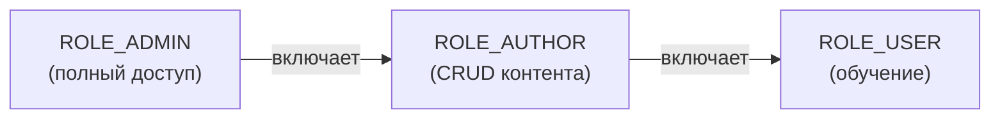
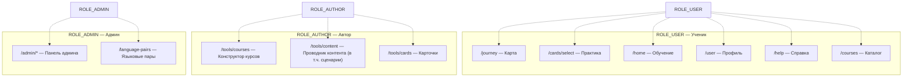

# Архитектура: UI по ролям (Roles & Zones)

Организация пользовательского интерфейса в зависимости от ролей. Маршруты, меню, виджеты и страницы — что видит каждый тип пользователя.

## Назначение

Этот документ — справочник по организации UI для трёх ролей:

| Роль | Код | Доступ |
|------|-----|--------|
| Ученик | `ROLE_USER` | Обучение, практика, профиль |
| Автор курса | `ROLE_AUTHOR` | Всё + CRUD контента |
| Администратор | `ROLE_ADMIN` | Всё + системные настройки |

> **Подписка и доступ** — отдельная доменная область. Подписка влияет на разблокировку контента, но не определяет роль. См. [ARCHITECTURE.subscription.md](./ARCHITECTURE.subscription.md).

## Модель ролей

```typescript
// src/app/entities/auth/services/role.service.ts

export type UserRole = 'ROLE_USER' | 'ROLE_AUTHOR' | 'ROLE_ADMIN';

@Injectable({ providedIn: 'root' })
export class RoleService {
  private readonly authStore = inject(AuthStore);

  readonly roles = computed(() => this.authStore.user()?.roles ?? []);
  readonly isUser = computed(() => this.roles().includes('ROLE_USER'));
  readonly isAuthor = computed(() => this.roles().includes('ROLE_AUTHOR'));
  readonly isAdmin = computed(() => this.roles().includes('ROLE_ADMIN'));

  // Комбинированные права
  readonly canCreateContent = computed(() => this.isAuthor() || this.isAdmin());
  readonly canManageSystem = computed(() => this.isAdmin());
}
```

### Иерархия доступа



- **`ROLE_USER`** — базовый доступ: обучение, практика, профиль.
- **`ROLE_AUTHOR`** — все права `ROLE_USER` + создание/редактирование контента.
- **`ROLE_ADMIN`** — все права `ROLE_AUTHOR` + системные настройки.

## Карта маршрутов по ролям



### Детальная таблица маршрутов

| Маршрут | Компонент | ROLE_USER | ROLE_AUTHOR | ROLE_ADMIN | Guard |
|---------|-----------|:---------:|:-----------:|:----------:|-------|
| `/journey` | `JourneyPageComponent` | ✅ | ✅ | ✅ | `authGuard` |
| `/cards/select` | `CardSelectPageComponent` | ✅ | ✅ | ✅ | `authGuard` |
| `/home` | `HomePageComponent` | ✅ | ✅ | ✅ | `authGuard` |
| `/home/progress` | `LearningProgressComponent` | ✅ | ✅ | ✅ | `authGuard` |
| `/courses` | `CourseCatalogPageComponent` | ✅ | ✅ | ✅ | `authGuard` |
| `/user` | `UserPageComponent` | ✅ | ✅ | ✅ | `authGuard` |
| `/help` | `HelpPageComponent` | ✅ | ✅ | ✅ | `authGuard` |
| `/help/scenarios` | `HelpUsageScenariosPageComponent` | ✅ | ✅ | ✅ | `authGuard` |
| `/tools/courses` | `CourseBuilderPageComponent` | ❌ | ✅ | ✅ | `authorGuard` |
| `/tools/content` | `ContentExplorerPageComponent` | ❌ | ✅ | ✅ | `authorGuard` |
| `/tools/scenario-builder` | — (redirect → `/tools/content`) | ❌ | ✅ | ✅ | `authorGuard` |
| `/tools/cards` | `CardEditorPageComponent` | ❌ | ✅ | ✅ | `authorGuard` |
| `/tools/language-pairs` | `PairRegistryComponent` | ❌ | ✅ | ✅ | `authorGuard` |
| `/admin` | `AdminPageComponent` | ❌ | ❌ | ✅ | `adminGuard` |

## Карта меню и виджетов

### Header (widgets/main-header)

```
┌─────────────────────────────────────────────────────────────────┐
│  menu-cards    menu-tools    menu-help    menu-user            │
└─────────────────────────────────────────────────────────────────┘
```

| Виджет | ROLE_USER | ROLE_AUTHOR | ROLE_ADMIN | Описание |
|--------|:---------:|:-----------:|:----------:|----------|
| `menu-cards` | ✅ | ✅ | ✅ | Обучение: Карта, Практика, Обучение, Каталог |
| `menu-tools` | ❌ | ✅ | ✅ | Инструменты: Конструктор курсов, сценариев, Карточки |
| `menu-help` | ✅ | ✅ | ✅ | Справка, Сценарии использования |
| `menu-user` | ✅ | ✅ | ✅ | Профиль, Выйти |

### Sidebar (widgets/sidebar-navigation-left)

```
┌─────────────────────────────────────────────────────────────────┐
│  🗺️  Карта                                                      │
│  📝  Практика                                                   │
│  🎓  Обучение                                                   │
│  📚  Каталог курсов                                             │
│  ─────────────────────────────────────────────────────────────  │
│  🔄  Языковые пары         [только AUTHOR/ADMIN]               │
│  📖  Конструктор курсов    [только AUTHOR/ADMIN]               │
│  🌳  Проводник контента    [только AUTHOR/ADMIN]               │
│  🎨  Карточки              [только AUTHOR/ADMIN]               │
│  ─────────────────────────────────────────────────────────────  │
│  👤  Профиль                                                  │
└─────────────────────────────────────────────────────────────────┘
```

| Группа | Ссылки | ROLE_USER | ROLE_AUTHOR | ROLE_ADMIN |
|--------|--------|:---------:|:-----------:|:----------:|
| **Обучение** | Карта, Практика, Обучение, Каталог | ✅ | ✅ | ✅ |
| **Инструменты** | Проводник контента, Конструктор курсов, Карточки | ❌ | ✅ | ✅ |
| **Аккаунт** | Профиль | ✅ | ✅ | ✅ |

## Реализация

### 1. Guards для маршрутов

```typescript
// src/app/entities/auth/guards/author.guard.ts
import { CanMatchFn, inject } from '@angular/core';
import { RoleService } from '../services/role.service';

export const authorGuard: CanMatchFn = () => {
  const roleService = inject(RoleService);
  return roleService.canCreateContent();
};

// src/app/entities/auth/guards/admin.guard.ts
import { CanMatchFn, inject } from '@angular/core';
import { RoleService } from '../services/role.service';

export const adminGuard: CanMatchFn = () => {
  const roleService = inject(RoleService);
  return roleService.canManageSystem();
};
```

Применение в `app.routes.ts`:

```typescript
{
  path: 'tools/courses',
  loadComponent: () => import('./pages/course-builder/...'),
  canMatch: [authorGuard],
},
{
  path: 'admin',
  loadComponent: () => import('./pages/admin/...'),
  canMatch: [adminGuard],
}
```

### 2. Скрытие меню через `@if` в шаблонах

**menu-tools.component.html:**

```html
<button mat-button [matMenuTriggerFor]="toolsMenu" class="menu-tools__trigger">
  <mat-icon>build</mat-icon>
  Инструменты
</button>

<mat-menu #toolsMenu="matMenu">
  @if (roleService.canCreateContent()) {
    <a mat-menu-item routerLink="/tools/courses" routerLinkActive="menu-link--active">
      <mat-icon>menu_book</mat-icon>
      <span>Конструктор курсов</span>
    </a>
    <a mat-menu-item routerLink="/tools/content" routerLinkActive="menu-link--active">
      <mat-icon>account_tree</mat-icon>
      <span>Проводник контента</span>
    </a>
    <a mat-menu-item routerLink="/tools/cards" routerLinkActive="menu-link--active">
      <mat-icon>style</mat-icon>
      <span>Карточки</span>
    </a>
  } @else {
    <span mat-menu-item class="menu-link--disabled">
      <mat-icon>lock</mat-icon>
      <span>Доступно авторам</span>
    </span>
  }
</mat-menu>
```

**menu-tools.component.ts:**

```typescript
@Component({
  changeDetection: ChangeDetectionStrategy.OnPush,
  selector: 'app-menu-tools',
  imports: [RouterLink, RouterLinkActive, MatButtonModule, MatIconModule, MatMenuModule],
  templateUrl: './menu-tools.component.html',
})
export class MenuToolsComponent {
  readonly roleService = inject(RoleService);
}
```

### 3. Конфигурация sidebar-навигации

Текущий `SidebarNavigationLeftComponent` определяет группы инлайн. Для ролевого разделения — вынести конфигурацию в сервис:

```typescript
// src/app/widgets/sidebar-navigation-left/sidebar-nav-config.ts

export type NavItem = {
  label: string;
  path: string;
  icon: string;
  roles?: UserRole[]; // undefined = всем
};

export type NavGroup = {
  id: string;
  label?: string;
  items: readonly NavItem[];
};

export const SIDEBAR_NAV_CONFIG: readonly NavGroup[] = [
  {
    id: 'learning',
    items: [
      { label: 'Карта', path: '/journey', icon: 'map' },
      { label: 'Практика', path: '/cards/select', icon: 'style' },
      { label: 'Обучение', path: '/home', icon: 'school' },
      { label: 'Каталог курсов', path: '/courses', icon: 'menu_book' },
    ],
  },
  {
    id: 'tools',
    items: [
      { label: 'Языковые пары', path: '/tools/language-pairs', icon: 'swap_horiz', roles: ['ROLE_AUTHOR', 'ROLE_ADMIN'] },
      { label: 'Конструктор курсов', path: '/tools/courses', icon: 'menu_book', roles: ['ROLE_AUTHOR', 'ROLE_ADMIN'] },
      { label: 'Проводник контента', path: '/tools/content', icon: 'account_tree', roles: ['ROLE_AUTHOR', 'ROLE_ADMIN'] },
      { label: 'Карточки', path: '/tools/cards', icon: 'style', roles: ['ROLE_AUTHOR', 'ROLE_ADMIN'] },
    ],
  },
  {
    id: 'account',
    items: [{ label: 'Профиль', path: '/user', icon: 'person_outline' }],
  },
];
```

```typescript
// sidebar-navigation-left.component.ts

@Component({
  changeDetection: ChangeDetectionStrategy.OnPush,
  selector: 'app-sidebar-navigation-left',
  imports: [RouterLink, RouterLinkActive, MatDividerModule, MatListModule, MatIconModule],
  templateUrl: './sidebar-navigation-left.component.html',
})
export class SidebarNavigationLeftComponent {
  private readonly roleService = inject(RoleService);

  readonly groups = computed(() =>
    SIDEBAR_NAV_CONFIG.map(group => ({
      ...group,
      items: group.items.filter(item =>
        !item.roles || item.roles.some(r => this.roleService.hasRole(r as UserRole))
      ),
    })).filter(group => group.items.length > 0), // скрывать пустые группы
  );
}
```

### 4. Скрытие групп в sidebar

Если группа не содержит видимых элементов (все ссылки скрыты ролью), группа скрывается автоматически через `.filter(group => group.items.length > 0)`.

## Паттерн: блокировка контента

Для контента, доступного по подписке (бэклог):

```html
@if (roleService.canCreateContent()) {
  <app-course-builder-dialog />
} @else {
  <mat-card class="locked-content">
    <mat-icon>lock</mat-icon>
    <p>Доступно авторам курсов</p>
    @if (subscriptionStore.hasActiveSubscription()) {
      <button mat-raised-button color="primary" routerLink="/subscribe">
        Подписаться
      </button>
    }
  </mat-card>
}
```

## Карта изменений в коде

### Уже реализовано

| Элемент | Файл | Статус |
|---------|------|--------|
| `RoleService` | `entities/auth/services/role.service.ts` | ✅ `ROLE_USER` + `ROLE_ADMIN` |
| `AuthStore` | `entities/auth/services/auth.store.ts` | ✅ извлекает roles из JWT |
| `authGuard` | `entities/auth/guards/auth.guard.ts` | ✅ базовый guard |
| `notAuthGuard` | `entities/auth/guards/not-auth.guard.ts` | ✅ редирект с `/login` |
| `menu-cards` | `widgets/menu-cards/` | ✅ всем |
| `menu-help` | `widgets/menu-help/` | ✅ всем |
| `menu-user` | `widgets/menu-user/` | ✅ всем |

### Нужно добавить

| Элемент | Файл | Роль |
|---------|------|------|
| `ROLE_AUTHOR` | `role.service.ts` | Добавить `isAuthor` |
| `authorGuard` | `entities/auth/guards/author.guard.ts` | Новый guard |
| `adminGuard` | `entities/auth/guards/admin.guard.ts` | Новый guard |
| `menu-tools` | `widgets/menu-tools/menu-tools.component.ts` | Добавить `RoleService`, `@if` в шаблон |
| `sidebar-nav-config` | `widgets/sidebar-navigation-left/sidebar-nav-config.ts` | Вынести конфиг в сервис |
| `sidebar-navigation-left` | `sidebar-navigation-left.component.ts` | Использовать `RoleService` + `computed` |
| Маршруты `/tools/*` | `app.routes.ts` | Добавить `canMatch: [authorGuard]` |

## Связанные документы

- [DOMAIN.md](../DOMAIN.md) — доменная модель
- [ARCHITECTURE.md](../PRODUCT/ARCHITECTURE.md) — обзор архитектуры
- [ARCHITECTURE.roles-zones.md](./ARCHITECTURE.roles-zones.md) — роли и зоны доступа
- [ARCHITECTURE.subscription.md](./ARCHITECTURE.subscription.md) — подписка (бэклог)
- [auth.rule.md](../../.continue/rules/05.business.07.auth.rule.md) — аутентификация
- [routing.rule.md](../../.continue/rules/02.architecture.05.routing.rule.md) — guards и роутинг
