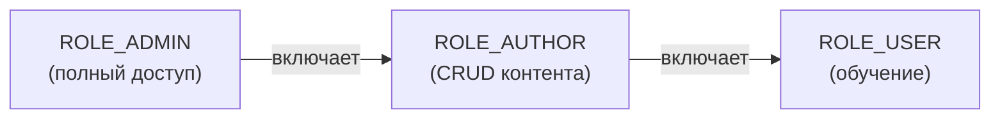

# Архитектура: роли и зоны доступа (Roles & Zones)

Три роли приложения, соответствующие зонам доступа. Роли определяют, какие маршруты, UI-элементы и данные доступны пользователю.

## Зоны

```text
┌──────────────────────────────────────────────────────────────┐
│                        LinguaCode                            │
│                                                              │
│  ┌─────────────┐  ┌────────────────┐  ┌──────────────────┐  │
│  │  Ученик     │  │   Автор курса  │  │  Администратор   │  │
│  │  ROLE_USER  │  │  ROLE_AUTHOR   │  │   ROLE_ADMIN     │  │
│  │             │  │                │  │                  │  │
│  │ • Обучение  │  │ • CRUD курсов  │  │ • Управление     │  │
│  │ • Практика  │  │ • Карточки     │  │   языковыми парами│  │
│  │ • Сценарии  │  │ • Сценарии     │  │ • Просмотр логов │  │
│  │ • Профиль   │  │ • Каталог      │  │ • Настройки      │  │
│  └─────────────┘  └────────────────┘  └──────────────────┘  │
└──────────────────────────────────────────────────────────────┘
```

## 1. Ученик (ROLE_USER)

Базовый доступ. Пользователь изучает языки через карточки, сценарии и треки.

### Доступные маршруты

| Маршрут | Компонент | Описание |
|---------|-----------|----------|
| `/home` | `HomePageComponent` | Dashboard: что делать дальше |
| `/journey` | `JourneyPageComponent` | Путь обучения (roadmap) |
| `/cards/select` | `CardSelectPageComponent` | Практика: выбор сценария, прогон |
| `/user` | `UserPageComponent` | Профиль, настройки, языковые пары |
| `/help` | `HelpPageComponent` | Справка |
| `/help/scenarios` | `HelpUsageScenariosPageComponent` | Сценарии использования |

### Доступные виджеты

- `menu-cards` — навигация к карточкам и обучению
- `menu-help` — справка
- `menu-user` — профиль и настройки

### Права

- Просмотр и прохождение карточек
- Прохождение сценариев в обучении (read-only использование контента)
- Настройка профиля и языковых пар (`users.preferences` — только свои данные)
- Просмотр прогресса обучения
- Выбор пар из каталога реестра через поиск на вкладке «Мои пары» профиля (`/user`) — реестр read-only

> **Примечание (решение по сценарию-билдеру):** CRUD сценариев (`scenario-builder`) доступен только `ROLE_AUTHOR` / `ROLE_ADMIN` — маршрут `/tools/scenario-builder` защищён `authorGuard`. Роль `ROLE_USER` не создаёт и не редактирует сценарии.

## 2. Автор курса (ROLE_AUTHOR)

Расширенный доступ. Автор создаёт и редактирует контент: курсы, программы, уроки, карточки.

### Дополнительные маршруты

| Маршрут | Компонент | Описание |
|---------|-----------|----------|
| `/tools/cards` | `CardEditorPageComponent` | CRUD карточек, каталог |
| `/tools/scenario-builder` | `ScenarioBuilderPageComponent` | Конструктор сценариев |
| `/tools/courses` | `CourseBuilderPageComponent` | Конструктор курсов и программ |
| `/tools/language-pairs` | `PairRegistryComponent` | CRUD реестра языковых пар (`/language-pairs`) |
| `/courses` | `CourseCatalogPageComponent` | Каталог программ |

### Дополнительные виджеты

- `menu-tools` — инструменты автора (карточки, конструктор сценариев)

### Права

- Все права ROLE_USER
- Создание/редактирование/удаление карточек
- Создание/редактирование сценариев (системных и пользовательских)
- Создание/редактирование курсов и программ
- Публикация контента (`published: true`)

## 3. Администратор (ROLE_ADMIN)

Полный доступ. Администратор управляет справочником языков, системными настройками и просмотром данных.

### Дополнительные маршруты

| Маршрут | Компонент | Описание |
|---------|-----------|----------|
| `/admin` | `AdminPageComponent` | Панель администратора: вкладка «Справочник языков» ([LanguageRegistryComponent](../../src/app/features/language-registry/components/language-registry/language-registry.component.ts)) |

> CRUD **реестра пар** (`/language-pairs`) принадлежит author-зоне `/tools/language-pairs` — доступен и админу (`canCreateContent`). `/language-pairs` (legacy) редиректит на `/tools/language-pairs`.

### Права

- Все права ROLE_AUTHOR
- CRUD справочника языков (`languages` API)
- Управление пользователями (бэклог)
- Просмотр системных логов и метрик (бэклог)
- Управление seed-контентом (бэклог)

## Модель ролей

```typescript
// src/app/entities/auth/services/role.service.ts

export type UserRole = 'ROLE_USER' | 'ROLE_AUTHOR' | 'ROLE_ADMIN';

@Injectable({ providedIn: 'root' })
export class RoleService {
  private readonly authStore = inject(AuthStore);

  /** All roles assigned to the current user. */
  readonly roles = computed(() => this.authStore.user()?.roles ?? []);

  /** Whether the user has the USER role. */
  readonly isUser = computed(() => this.roles().includes('ROLE_USER'));

  /** Whether the user has the AUTHOR role. */
  readonly isAuthor = computed(() => this.roles().includes('ROLE_AUTHOR'));

  /** Whether the user has the ADMIN role. */
  readonly isAdmin = computed(() => this.roles().includes('ROLE_ADMIN'));

  /** Whether the user can perform write operations on content. */
  readonly canCreateContent = computed(() => this.isAuthor() || this.isAdmin());

  /** Whether the user can manage system settings. */
  readonly canManageSystem = computed(() => this.isAdmin());

  /**
   * Checks if the user has a specific role.
   * @param role - The role code to check.
   * @returns `true` if the user has the role.
   */
  hasRole(role: UserRole): boolean {
    return this.roles().includes(role);
  }
}
```

## Иерархия доступа



- **`ROLE_USER`** — базовый доступ: обучение, практика, профиль.
- **`ROLE_AUTHOR`** — все права `ROLE_USER` + создание/редактирование контента.
- **`ROLE_ADMIN`** — все права `ROLE_AUTHOR` + системные настройки.

## Гейтинг маршрутов

Функциональные guards (`canMatch`) на основе `RoleService`:

```typescript
// src/app/entities/auth/guards/author.guard.ts
import { CanMatchFn, inject } from '@angular/core';
import { RoleService } from '../services/role.service';

export const authorGuard: CanMatchFn = () => {
  const roleService = inject(RoleService);
  return roleService.canCreateContent();
};

// src/app/entities/auth/guards/admin.guard.ts
import { CanMatchFn, inject } from '@angular/core';
import { RoleService } from '../services/role.service';

export const adminGuard: CanMatchFn = () => {
  const roleService = inject(RoleService);
  return roleService.canManageSystem();
};
```

Применение в `app.routes.ts`:

```typescript
{
  path: 'tools/cards',
  loadComponent: () => import('./pages/card-editor/...'),
  canMatch: [authorGuard],
},
{
  path: 'admin',
  loadComponent: () => import('./pages/admin/...'),
  canMatch: [adminGuard],
}
```

## Подписка и доступ

Подписка влияет на разблокировку контента, но не определяет роль. Пользователь с `ROLE_USER` может иметь активную подписку и получить доступ к премиум-контенту.

- **Базовый доступ** — все маршруты обучения (`/home`, `/cards/select`, `/journey`).
- **Премиум-контент** — разблокируется через `SubscriptionStore.hasActiveSubscription()`.
- **Авторский доступ** — разблокируется через `RoleService.canCreateContent()`.

Детали подписки — в [ARCHITECTURE.subscription.md](./ARCHITECTURE.subscription.md).

## Связанные документы

- [DOMAIN.md](../DOMAIN.md) — доменная модель
- [ARCHITECTURE.md](../PRODUCT/ARCHITECTURE.md) — обзор архитектуры
- [ARCHITECTURE.roles-ui.md](./ARCHITECTURE.roles-ui.md) — UI по ролям (меню, виджеты, шаблоны)
- [ARCHITECTURE.subscription.md](./ARCHITECTURE.subscription.md) — подписка и монетизация
- [auth.rule.md](../../.continue/rules/05.business.07.auth.rule.md) — аутентификация
- [routing.rule.md](../../.continue/rules/02.architecture.05.routing.rule.md) — guards и роутинг
