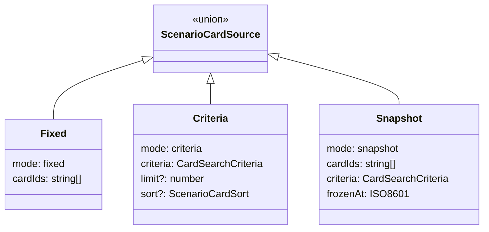

# Архитектура: конструктор сценариев (`scenario-builder`)

CRUD сценариев, `ScenarioCardSource`, публикация. Маршрут `/tools/scenario-builder`.

## Назначение

Сборка сценариев из fixed / criteria / snapshot карточек; scope по `LanguagePair`.

## Структура

```text
features/scenario-builder/
├── components/
│   ├── scenario-builder-dialog/     # dialog CRUD сценария
│   └── scenario-editor-form/        # форма редактора сценария
├── services/
│   ├── scenario-builder.store.ts    # стор сценариев
│   └── scenario-builder.service.ts  # сервис сценариев
├── types/                           # типы фичи
├── utils/
│   └── scenario-form-draft.utils.ts # утилиты черновиков формы
├── models/                          # модели (пустой barrel)
└── index.ts                         # barrel-экспорт
```

> **Примечание:** `scenario-builder-page` — это страница (page), а не компонент фичи. Она расположена в `pages/scenario-builder/scenario-builder-page/` и является точкой входа маршрута `/tools/scenario-builder`. Компоненты фичи (`features/scenario-builder/components/`) импортируются страницей.

## Модель `ScenarioCardSource`



## Особенности

- Список через `ScenarioSearchService` + pagination.
- Dialog CRUD (как card-editor).
- Read-only для чужих опубликованных сценариев (G11e multi-user).
- Прохождение — [ARCHITECTURE.card-select.md](./ARCHITECTURE.card-select.md).

## Зависимости

- `features/card-catalog-search/` — `ScenarioCardPickerComponent`, `ScenarioCardCriteriaEditorComponent`, `CardCatalogSearchStore`
- `entities/chinese/ui/` — course-picker, lesson-picker, scenario-picker, card-host, pinyin-keyboard

## Связанные документы

- [SCENARIO-BUILDER.md](./FEATURES/SCENARIO-BUILDER.md) · [CARD-CATALOG.md](./COMMON/CARD-CATALOG.md)
