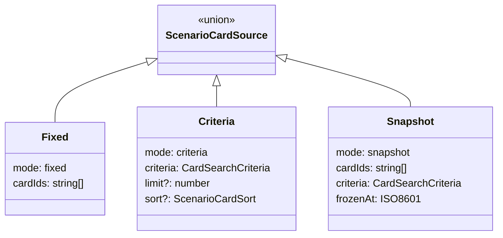
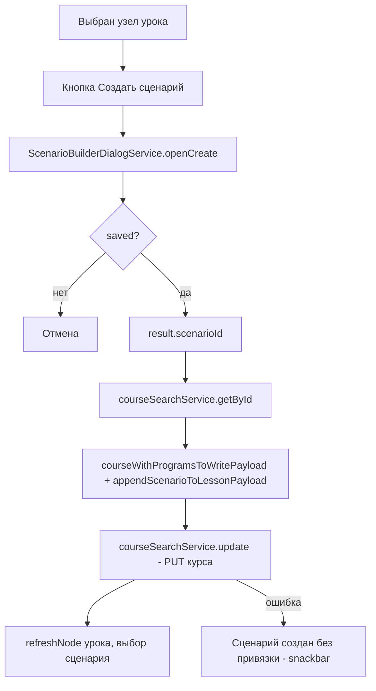

# Архитектура: сценарии (`scenario-builder`)

> **Статус:** миграция в «Проводник контента» выполнена (план [crisp-tiger-plan-scenario.md](../../crisp-tiger-plan-scenario.md), этапы 1–7). Отдельная страница `pages/scenario-builder/` удалена; маршрут `/tools/scenario-builder` редиректит на `/tools/content` (`app.routes.ts`, под `authorGuard`). Feature-слайс `features/scenario-builder/` сохранён: общий диалог `scenario-builder-dialog`, `ScenarioBuilderStore` и form-утилиты используются Проводником контента — управление сценариями живёт в дереве Проводника и в «Каталоге сценариев» (см. [ARCHITECTURE.content-explorer.md](./ARCHITECTURE.content-explorer.md)).

CRUD сценариев, `ScenarioCardSource`, публикация.

## Назначение

Сборка сценариев из fixed / criteria / snapshot карточек; scope по `LanguagePair`.

## Структура

```text
features/scenario-builder/
├── components/
│   ├── scenario-builder-dialog/     # dialog CRUD сценария (общий, используется Проводником)
│   └── scenario-editor-form/        # форма редактора сценария
├── services/
│   ├── scenario-builder.store.ts    # стор сценариев (providedIn: 'root')
│   └── scenario-builder.service.ts  # сервис сценариев
├── types/                           # типы фичи
├── utils/
│   └── scenario-form-draft.utils.ts # утилиты черновиков формы
├── models/                          # модели (пустой barrel)
└── index.ts                         # barrel-экспорт
```

> **Примечание:** страница `pages/scenario-builder/` удалена (этап 5 миграции), включая пункт сайдбара и ссылку в `menu-tools` (обе точки входа ведут на `/tools/content` — «Проводник контента»); help-страницы также ссылаются на `/tools/content`. Маршрут `/tools/scenario-builder` оставлен как plain redirect (обе зоны под `authorGuard`, значимых query-параметров у старой страницы не было).

## Модель `ScenarioCardSource`



## Черновик формы

`ScenarioFormDraft` (`utils/scenario-form-draft.utils.ts`) содержит поля `published`, `sourceMode`, `fixedCardIds` (а также `criteria*`, `snapshotFrozenAt`), которые **не выводятся в UI**: текущая форма редактора показывает только «Название», «Описание», «Известный язык», «Новый язык». Для нового сценария `sourceMode = 'fixed'` с пустым `fixedCardIds`; при редактировании источник карточек сохраняется round-trip'ом через черновик (`scenarioToFormDraft` / `formDraftToScenarioDraft`).

## Интеграция с Проводником контента

Управление сценариями выполняется в Проводнике (`/tools/content`); фича-слайс предоставляет диалог, store и form-утилиты. Оркестрация — на page-слое Проводника (`pages/content-explorer/`), FSD-совместимо (pages → features).

### Привязка сценария к уроку (создание из узла урока)



1. `ScenarioBuilderDialogService.openCreate()` сохраняет сценарий через
   `ScenarioBuilderStore.createScenario(draft)` и закрывается с
   `result.scenarioId`.
2. `createScenario` возвращает **созданный `Scenario | null`** (раньше —
   `boolean`): `null` — при ошибке валидации черновика или API.
3. Страница Проводника (`content-explorer-page.component.ts →
   onAddScenarioRequested`) при `saved && scenarioId` и выбранном
   lesson-узле (`kind === 'lesson'`, `editable`, не virtual):
   - course-узел ищется через `store.pathOf(lessonNode)`;
   - `courseSearchService.getById(courseId)` → `CourseWithPrograms`;
   - entity-маппер `courseWithProgramsToWritePayload(course)`
     (`entities/course/utils/`) — чистый маппинг полей **без** бизнес-валидаций
     `CourseBuilderStore.normalizeDraft` (в т.ч. без «в каждом уроке ≥ 1 сценарий»);
   - `appendScenarioToLessonPayload(payload, lessonId, scenarioId)` —
     append с dedupe, порядок `scenarioIds` сохраняется;
   - `courseSearchService.update(courseId, payload)` (PUT `/courses/{id}`)
     + `clearGetByIdCache()` (свежий `getById` перед PUT — защита от lost update);
   - `store.refreshNode(lessonNode)` — сценарий появляется дочерним узлом
     урока; новый scenario-узел выбирается; snackbar «Сценарий создан
     и добавлен в урок».
4. Ошибка привязки **некритична**: сценарий уже создан — snackbar
   «Сценарий создан, но не удалось привязать его к уроку…», откат не
   выполняется. Сценарий, созданный без lesson-контекста («Каталог
   сценариев»), привязки не требует.

Единственный путь записи привязки — обновление курса целиком:
`LessonUpdateRequest` (сгенерированный API) не содержит `scenarioIds` —
ограничение зафиксировано как future improvement (см. план миграции).

### Удаление сценария

- Кнопка «Удалить» в detail-панели видна только при `canEditOwnScenario()`
  — проверка владения по данным узла (`isEditableContentAuthor`).
- Подтверждение обязательное: `scenario-delete-confirm-dialog.component.ts`
  (pages-слой Проводника; текст «Сценарий „{title}“ будет удалён
  безвозвратно»); отмена ничего не удаляет.
- `ScenarioBuilderStore.deleteScenario(scenarioId, entry?)`: владение
  проверяется по переданному `entry` (Проводник собирает
  `ScenarioIndexEntry` из данных scenario-узла), иначе — по текущей странице
  списка, иначе — `getById` fallback; если владение доказать не удалось,
  удаление отклонено (fail-safe). Чужой сценарий удалить невозможно:
  кнопка скрыта гейтом + guard в store.
- Защитный каскад: после удаления Проводник убирает id сценария из
  `lesson.scenarioIds` точечным PUT курса
  (`removeScenarioFromLessonPayload`, идемпотентно — если бэкенд уже убрал
  id, payload не меняется и PUT не нужен), затем `refreshNode(lesson)` и
  снятие выделения.

### «Каталог сценариев»

Inline-панель в header Проводника; переиспользует `ScenarioBuilderStore`
(root-синглтон): `loadList` / `setListScope` / `setPage`.

- scope-тумблер «Мои / Опубликованные / Все» (`setListScope` сбрасывает
  пагинацию на страницу 0; список перезагружает панель);
- пагинация (`UiPaginationComponent`, `setPage` + счётчик `totalItems`);
- «Создать сценарий» (`openCreate` без привязки) и «Редактировать»
  (`openEdit` — общий диалог, чужие сценарии read-only); дерево при этом
  не меняется: автономные сценарии в дереве не живут;
- список перезагружается при каждом открытии панели (состояние store
  могло устареть);
- поиска и фильтра-чипов по курсам нет (осознанное упрощение; поиск
  покрыт фильтром дерева Проводника).

## Store API

```typescript
// features/scenario-builder/services/scenario-builder.store.ts
class ScenarioBuilderStore {
  /** Создаёт сценарий; возвращает созданный Scenario или null (валидация/API). */
  async createScenario(draft: ScenarioDraft): Promise<Scenario | null>;

  /**
   * Удаляет сценарий. Владение: по entry (если передан) → по текущей
   * странице списка → getById fallback; fail-safe при неудаче.
   */
  async deleteScenario(scenarioId: string, entry?: ScenarioIndexEntry): Promise<void>;

  /** Чужой сценарий — read-only (G11e multi-user). */
  readonly isReadOnly: Signal<boolean>;
}

// features/scenario-builder/components/scenario-builder-dialog/scenario-builder-dialog.types.ts
type ScenarioBuilderDialogResult = {
  saved: boolean;
  /** ID созданного/обновлённого сценария (только при saved: true). */
  scenarioId?: string;
};
```

## Особенности

- Dialog CRUD (как card-editor): создание / редактирование / просмотр через `ScenarioBuilderDialogService`.
- Форма диалога — 4 поля («Название», «Описание», «Известный язык», «Новый язык»); сохранение — «Сохранить», отмена с discard-confirm через `CardEditorDiscardDialogComponent` при dirty draft.
- Read-only для чужих сценариев (`ScenarioBuilderStore.isReadOnly`) — G11e multi-user.
- Прохождение — [ARCHITECTURE.card-select.md](./ARCHITECTURE.card-select.md).

## Зависимости

- `entities/card/` — `CardCatalogSearchStore` (providers dialog-компонента, зарезервировано для picker/criteria editor), `CardSearchService`, типы `ScenarioCardSource`
- `entities/course/` — `CourseSearchService` (кэш курсов в store; привязка сценария к уроку выполняется на page-слое Проводника через `courseWithProgramsToWritePayload`)
- `entities/language-pair/` — `LanguageService` (списки языков в select-ах формы)
- `entities/user/` — `isEditableContentAuthor` (`ROLE_AUTHOR` / `ROLE_ADMIN`)
- `shared/ui/dialogs/` — `CardEditorDiscardDialogComponent`

## Связанные документы

- [SCENARIO-BUILDER.md](../FEATURES/SCENARIO-BUILDER.md) · [ARCHITECTURE.content-explorer.md](./ARCHITECTURE.content-explorer.md) · [CARD-CATALOG.md](../COMMON/CARD-CATALOG.md)
