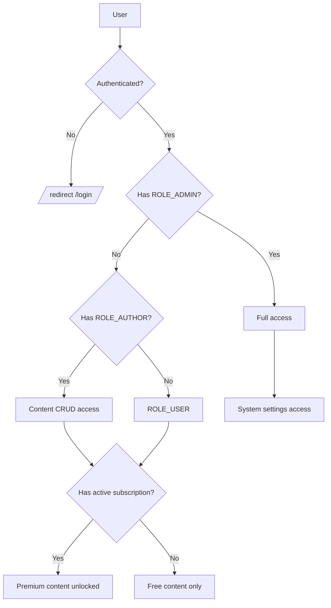

# Архитектура: подписка и монетизация (Subscription)

Модель подписок, уровней доступа и разблокировки контента. Подписка — отдельная доменная область, которая пересекается с ролями, но не сводится к ним.

## Назначение

Подписка определяет доступ к премиум-контенту независимо от роли пользователя:

| Сценарий | Роль          | Подписка | Доступ                                 |
| -------- | ------------- | -------- | -------------------------------------- |
| Гостий   | —             | нет      | Только `/login`, `/help`               |
| Ученик   | `ROLE_USER`   | нет      | Базовый контент, бесплатные курсы      |
| Ученик   | `ROLE_USER`   | Pro      | Весь контент, включая премиум          |
| Автор    | `ROLE_AUTHOR` | нет      | Свой контент доступен всем подписчикам |
| Автор    | `ROLE_AUTHOR` | Pro      | Свой контент + премиум-функции         |
| Админ    | `ROLE_ADMIN`  | любая    | Полный доступ ко всему                 |

## Сущности

```typescript
// src/app/entities/subscription/model/subscription.types.ts

/** Уровни подписки. */
export type PlanLevel = 'free' | 'pro' | 'team';

/** Тариф подписки. */
export type Plan = {
  id: string;
  level: PlanLevel;
  name: string;
  description: string;
  price: {
    amount: number;
    currency: 'RUB' | 'USD';
  };
  period: 'month' | 'year';
  /** Какие права даёт тариф. */
  features: readonly PlanFeature[];
  /** Доступные уровни для апгрейда. */
  upgradeFrom?: readonly PlanLevel[];
};

/** Функция тарифа. */
export type PlanFeature =
  | { type: 'content_access'; contentIds: readonly string[] }
  | { type: 'unlimited_scenarios' }
  | { type: 'unlimited_cards' }
  | { type: 'priority_support' }
  | { type: 'custom_branding' };

/** Активная подписка пользователя. */
export type Subscription = {
  id: string;
  userId: string;
  planId: string;
  status: 'active' | 'past_due' | 'canceled' | 'expired';
  currentPeriodStart: string; // ISO 8601
  currentPeriodEnd: string; // ISO 8601
  cancelAtPeriodEnd: boolean;
  trialEnd?: string; // ISO 8601
};

/** История платежей. */
export type BillingEvent = {
  id: string;
  subscriptionId: string;
  type: 'charge' | 'refund' | 'trial_started' | 'trial_ended';
  amount: number;
  currency: 'RUB' | 'USD';
  status: 'succeeded' | 'pending' | 'failed';
  createdAt: string; // ISO 8601
  metadata?: Record<string, unknown>;
};

/** Запрос на создание/изменение подписки. */
export type CreateSubscriptionRequest = {
  planId: string;
  promoCode?: string;
};

/** Ответ при успешном создании подписки. */
export type CreateSubscriptionResponse = {
  subscription: Subscription;
  nextBillingDate: string;
};
```

## Модель доступа к контенту

```typescript
// src/app/entities/content/model/content-access.types.ts

/** Уровень доступа к контенту. */
export type AccessLevel = 'free' | 'premium' | 'author-specific';

/** Метаданные доступа к контенту. */
export type ContentAccess = {
  /** Уровень доступа. */
  level: AccessLevel;
  /** Какой план нужен для доступа (undefined = free). */
  requiredPlan?: PlanLevel;
  /** ID автора (для авторского контента). */
  authorId?: string;
  /** ID курса/программы (для привязки к подписке). */
  courseId?: string;
};
```

### Примеры

```typescript
// Бесплатная карточка
{ level: 'free' }

// Премиум-курс
{ level: 'premium', requiredPlan: 'pro' }

// Авторский курс (доступен всем авторам)
{ level: 'author-specific', authorId: 'user-123' }
```

## Гейтинг подписки

### SubscriptionGuard

```typescript
// src/app/entities/subscription/guards/subscription.guard.ts
import { CanMatchFn, inject } from '@angular/core';
import { SubscriptionStore } from '../services/subscription.store';

export const subscriptionGuard: CanMatchFn = (route, segments) => {
  const subscriptionStore = inject(SubscriptionStore);
  const requiredPlan = route.data?.['requiredPlan'] as PlanLevel | undefined;

  if (!requiredPlan) {
    return true;
  }

  return subscriptionStore.hasPlan(requiredPlan);
};
```

### Применение в маршрутах

```typescript
{
  path: 'courses/premium',
  loadComponent: () => import('./pages/premium-courses/...'),
  data: { requiredPlan: 'pro' as PlanLevel },
  canMatch: [subscriptionGuard],
},
```

### UI-паттерн: блокировка контента

```html
@if (subscriptionStore.hasAccess(contentAccess)) {
<app-course-card [course]="course" />
} @else {
<mat-card class="locked-content">
  <mat-icon>lock</mat-icon>
  <p>{{ contentAccess.level === 'premium' ? 'Премиум-контент' : 'Доступно авторам' }}</p>

  @if (contentAccess.level === 'premium') { @if (subscriptionStore.hasActiveSubscription()) {
  <button mat-raised-button color="primary" routerLink="/courses/premium">Смотреть примеры</button>
  } @else {
  <button mat-raised-button color="primary" routerLink="/subscribe">Подписаться</button>
  } }
</mat-card>
}
```

## SubscriptionStore

```typescript
// src/app/entities/subscription/services/subscription.store.ts

@Injectable({ providedIn: 'root' })
export class SubscriptionStore {
  private readonly subscriptionApi = inject(SubscriptionApiService);
  private readonly logger = inject(AppLoggerService);

  // State signals
  private readonly #state = signal<SubscriptionState>({
    subscriptions: [],
    currentPlan: null,
    loading: false,
    error: null,
  });

  // Derived signals
  readonly subscriptions = this.#state().subscriptions.asReadonly();
  readonly currentPlan = computed(() =>
    this.#state().subscriptions.find(s => s.status === 'active') ?? null,
  );
  readonly hasActiveSubscription = computed(() =>
    this.#state().subscriptions.some(s => s.status === 'active'),
  );
  readonly currentPlanLevel = computed(() =>
    this.currentPlan() ? this.#state().plans.find(p => p.id === this.currentPlan()!.planId)?.level : null,
  );

  // Actions
  loadSubscriptions(): void { ... }
  subscribe(request: CreateSubscriptionRequest): Promise<CreateSubscriptionResponse> { ... }
  cancelSubscription(subscriptionId: string): void { ... }
  hasPlan(level: PlanLevel): boolean {
    return this.currentPlanLevel() === level;
  }
  hasAccess(contentAccess: ContentAccess): boolean {
    if (contentAccess.level === 'free') return true;
    if (contentAccess.level === 'premium') return this.hasPlan(contentAccess.requiredPlan!);
    if (contentAccess.level === 'author-specific') return true; // TODO: check author
    return false;
  }
}
```

## Взаимодействие с ролями



### Матрица доступа

| Роль          | Подписка | Базовый контент | Премиум контент | CRUD контента | Системные настройки |
| ------------- | -------- | :-------------: | :-------------: | :-----------: | :-----------------: |
| `ROLE_USER`   | нет      |       ✅        |       ❌        |      ❌       |         ❌          |
| `ROLE_USER`   | Pro      |       ✅        |       ✅        |      ❌       |         ❌          |
| `ROLE_AUTHOR` | нет      |       ✅        |       ❌        |      ✅       |         ❌          |
| `ROLE_AUTHOR` | Pro      |       ✅        |       ✅        |      ✅       |         ❌          |
| `ROLE_ADMIN`  | любая    |       ✅        |       ✅        |      ✅       |         ✅          |

## Billing (бэклог)

### API-эндпоинты

| Метод   | Путь                                 | Описание                                  |
| ------- | ------------------------------------ | ----------------------------------------- |
| `GET`   | `/api/v1/subscriptions`              | Список подписок пользователя              |
| `POST`  | `/api/v1/subscriptions`              | Создание подписки                         |
| `PATCH` | `/api/v1/subscriptions/:id`          | Изменение подписки (отмена, смена тарифа) |
| `GET`   | `/api/v1/billing/events`             | История платежей                          |
| `POST`  | `/api/v1/billing/promo-codes/verify` | Проверка промокода                        |

### UI-страницы (бэклог)

| Маршрут            | Компонент                     | Описание                     |
| ------------------ | ----------------------------- | ---------------------------- |
| `/subscribe`       | `SubscribePageComponent`      | Выбор тарифа, оплата         |
| `/my-subscription` | `MySubscriptionPageComponent` | Текущая подписка, управление |
| `/billing`         | `BillingPageComponent`        | История платежей             |

## Связанные документы

- [ARCHITECTURE.roles-zones.md](./ARCHITECTURE.roles-zones.md) — роли и зоны доступа
- [DOMAIN.md](../DOMAIN.md) — доменная модель
- [ARCHITECTURE.md](../PRODUCT/ARCHITECTURE.md) — обзор архитектуры
- [auth.rule.md](../../.continue/rules/05.business.07.auth.rule.md) — аутентификация
- [security.rule.md](../../.continue/rules/05.business.01.security.rule.md) — безопасность платежей
