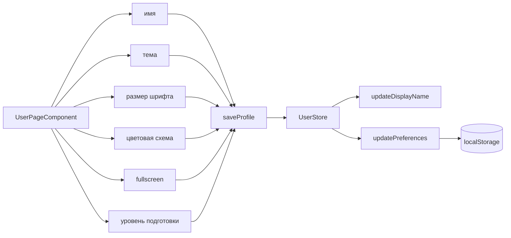

# Архитектура: профиль пользователя (`user`)

Страница настроек пользователя — управление отображением, языковыми парами и уровнем подготовки. Маршрут `/user`.

## Назначение

Центральный интерфейс для управления профилем пользователя:

- Отображаемое имя
- Тема оформления (тема, размер шрифта, цветовая схема)
- Полноэкранный режим карточек
- Уровень подготовки к обучению

## Структура

```text
pages/user/
└── user-page/
    ├── user-page.component.ts     # страница профиля
    ├── user-page.component.html   # шаблон с вкладками настроек
    ├── user-page.component.scss   # стили
    └── user-page.component.spec.ts# тесты
```

> **Примечание:** `user-page` — standalone-страница, точка входа маршрута `/user`. Не содержит фичи (`features/`), вся логика — в `UserStore` (`entities/user/model/`).

## Компонент

### UserPageComponent

**Imports:**

- `FormsModule` — двустороннее связывание форм
- `MatCardModule`, `MatFormFieldModule`, `MatInputModule` — поля ввода
- `MatSelectModule` — выпадающие списки (тема, размер шрифта)
- `MatButtonToggleModule` — переключатель цветовой схемы
- `MatIconModule`, `MatSlideToggleModule` — иконки и тогглы
- `MatTabsModule` — вкладки настроек

**Inputs (из UserStore):**

- `displayName` — computed signal, отображаемое имя
- `preferences` — computed signal, полный объект настроек
- `languages` — доступные языки контента
- `languageLabels` — метки языков

**Draft signals (черновики формы):**

| Signal                     | Тип                                   | По умолчанию                             | Описание                           |
| -------------------------- | ------------------------------------- | ---------------------------------------- | ---------------------------------- |
| `nameDraft`                | `Signal<string>`                      | `displayName()`                          | Отображаемое имя                   |
| `learningProficiencyDraft` | `Signal<LearningProficiencyLevel>`    | `preferences().learningProficiencyLevel` | Уровень подготовки                 |
| `themeDraft`               | `Signal<string>`                      | `preferences().theme`                    | Тема оформления                    |
| `fontSizeDraft`            | `Signal<UserPreferences['fontSize']>` | `preferences().fontSize`                 | Размер шрифта                      |
| `colorSchemeDraft`         | `Signal<AppColorScheme>`              | `preferences().colorScheme`              | Цветовая схема (light/dark/system) |
| `cardFocusFullscreenDraft` | `Signal<boolean>`                     | `preferences().cardFocusFullscreen`      | Полноэкранный режим карточек       |
| `selectedTabIndex`         | `Signal<number>`                      | `0`                                      | Текущая вкладка                    |

**Методы:**

- `saveProfile()` — коммит всех черновиков в `UserStore`:
  - `updateDisplayName(nameDraft())` — обновление имени
  - `updatePreferences({...})` — обновление всех настроек одним вызовом

**Lifecycle:**

- `ngOnInit()` — инициализация `learningProficiencyDraft` из `preferences()`

## UserStore

Центральный стор пользователя (`entities/user/model/user.store.ts`), `@Injectable({ providedIn: 'root' })`.

### Сигналы

| Сигнал                     | Тип                                       | Описание                               |
| -------------------------- | ----------------------------------------- | -------------------------------------- |
| `user`                     | `Signal<User>`                            | Текущий пользователь (readonly)        |
| `displayName`              | `Computed<string>`                        | Отображаемое имя                       |
| `preferences`              | `Computed<UserPreferences>`               | Полный объект настроек                 |
| `learningProficiencyLevel` | `Computed<LearningProficiencyLevel>`      | Уровень подготовки                     |
| `languagePairs`            | `Computed<UserLanguagePairEntry[]>`       | Все языковые пары                      |
| `activeLanguagePairId`     | `Computed<string>`                        | ID активной языковой пары              |
| `activeLanguagePairEntry`  | `Computed<UserLanguagePairEntry \| null>` | Запись активной пары                   |
| `languagePair`             | `Computed<LanguagePair>`                  | Разрешённая языковая пара              |
| `languagePairLabel`        | `Computed<string>`                        | Метка пары (напр. «Русский → English») |
| `cjkLearning`              | `Computed<...>`                           | Предпочтения CJK для активной пары     |
| `phonetic`                 | `Computed<...>`                           | Фонетические предпочтения              |
| `learningSession`          | `Computed<...>`                           | Настройки сессии обучения              |

### Методы

| Метод                                     | Описание                                    |
| ----------------------------------------- | ------------------------------------------- |
| `updateDisplayName(displayName)`          | Обновить имя (с санитизацией)               |
| `updatePreferences(partial)`              | Обновить настройки (с нормализацией)        |
| `updateLanguagePairSettings(id, patch)`   | Обновить настройки конкретной языковой пары |
| `updateLearningSession(patch)`            | Обновить настройки сессии активной пары     |
| `updateActiveLanguagePairSettings(patch)` | Обновить настройки активной пары            |
| `updateLanguagePair(languagePair)`        | Сменить языковую пару активной записи       |
| `addLanguagePair(pair)`                   | Добавить новую языковую пару                |
| `removeLanguagePair(id)`                  | Удалить языковую пару (минимум 1 остаётся)  |
| `setActiveLanguagePair(id)`               | Активировать языковую пару                  |
| `formatEntryLabel(entry)`                 | Получить метку языковой пары                |
| `isActiveEntry(entry)`                    | Проверить, активна ли запись                |

### Persistence

Постоянное хранение — `UserPersistence` (localStorage, ключ `lingua-code.user`). Данные сохраняются после каждой мутации.

### Default

```typescript
const DEFAULT_USER: User = {
  id: 'local-user',
  displayName: 'Ученик',
  preferences: {
    theme: 'azure-blue',
    fontSize: 'md',
    colorScheme: 'light',
    cardFocusFullscreen: false,
    learningProficiencyLevel: DEFAULT_LEARNING_PROFICIENCY_LEVEL,
    ...createDefaultLanguagePairPreferences(),
  },
};
```

## Flow настроек



## Связанные документы

- [ARCHITECTURE.md](../ARCHITECTURE.md) — обзор архитектуры
- [ARCHITECTURE.core.md](./ARCHITECTURE.core.md) — UserStore, overlay, content seed
- [LANGUAGE-PAIR.md](../FEATURES/LANGUAGE-PAIR.md) — языковые пары
