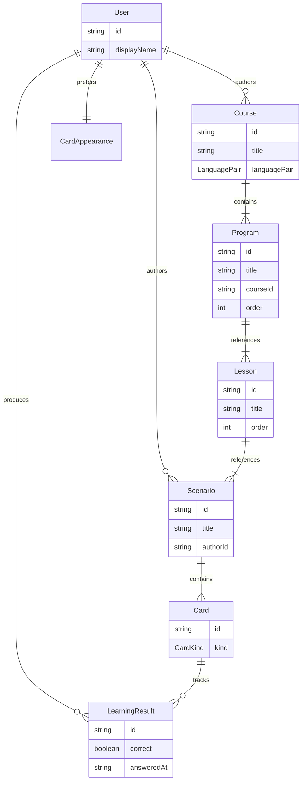

# Домен приложения LinguaCode

Доменная модель: сущности, типы, связи и терминология. Продуктовое видение и бизнес-идеи — в [BUSINESS.md](./BUSINESS.md). Оглавление документации — [INDEX.md](./INDEX.md).

## Назначение

`LinguaCode` — приложение для исследования и изучения языков. Основная единица домена — **карточка** (`Card`); карточки объединяются в **сценарии** (`Scenario`), сценарии — в **уроки** (`Lesson`), уроки — в **треки** (`Program`), треки — в **каталоги программ** (`Course`).

> **Статус иерархии:** `Card` → `Scenario` — **реализовано** (MVP). `Lesson` и `Course` — **реализовано** (G11). `Program` — **реализовано** (G17), см. [TASKS.md](../TASKS.md).

Техническая реализация: [ARCHITECTURE.md](./ARCHITECTURE.md).

## Иерархия контента

Учебный материал выстраивается снизу вверх:

```text
Card  →  Scenario  →  Lesson  →  Program  →  Course
```

| Уровень | Сущность   | Назначение                                              | Статус |
| ------- | ---------- | ------------------------------------------------------- | ------ |
| 1       | `Card`     | Атомарное упражнение (вопрос, пара, ввод…)              | MVP    |
| 2       | `Scenario` | Один прогон: фиксированный или criteria-набор карточек  | MVP    |
| 3       | `Lesson`   | Тема: несколько сценариев в заданном порядке            | G11    |
| 4       | `Program`  | Учебный трек: несколько уроков; привязан к `Course`     | G17    |
| 5       | `Course`   | Каталог программ: `LanguagePair`, `published`, `authoring` | G11   |

### Термины: не путать «курс», `Course` и `Program`

В UI и документации G7/G8 слово **«курс»** иногда означает **активную языковую пару** (ru→en, ru→zh) — scope контента в каталогах и обучении. В домене G11/G17:

| В речи / UI                         | В домене       | Пример                            |
| ----------------------------------- | -------------- | --------------------------------- |
| языковая пара, «курс ru→en» (G7/G8) | `LanguagePair` | `{ known: 'ru', learning: 'en' }` |
| каталог программ                    | `Course`       | «Английский A1: базовый»          |
| учебный трек                        | `Program`      | «Spring 2024», «Self-paced»       |
| тематический блок                   | `Lesson`       | «Урок 3: Приветствия»             |
| прогон упражнений                   | `Scenario`     | «Демо: приветствие»               |

Рекомендация для UI (G11e/G17): активный scope подписывать **«Курс: …»** (`LanguagePair`); сущность **`Course`** в UI называть **каталогом программ**; сущность **`Program`** — **учебным треком** / **модулем**.

## Learning Home (G13)

Точка входа обучения — **`/home`** (вкладка «Обучение»). Экран отвечает на вопрос **«что делать дальше»**, не дублируя пикеры с `/cards/select`.

| Элемент                   | Назначение                                                             |
| ------------------------- | ---------------------------------------------------------------------- |
| Hero                      | активный **курс** (`LanguagePair`) и **каталог** (`Course`)            |
| CTA «Продолжить / Начать» | deep link на `/cards/select?courseId&programId&lessonId&scenarioId&tab=learning` |
| Прогресс программы        | агрегация `LearningResultsStore.courseProgress`                        |
| Roadmap уроков            | locked / in progress / done (`lesson-prerequisites.utils`)             |
| Статистика                | краткая точность; подробности — `/home/progress`                       |

**Persistence:** `UserLanguagePairSettings.learning` (`LearningSessionPreferences`):

```typescript
type LearningSessionPreferences = {
  activeCourseId?: string;
  activeProgramId?: string;
  lastLessonId?: string;
  lastScenarioId?: string;
};
```

**Алгоритм resume:** `learning-resume.utils` → первый непройденный сценарий в разблокированном уроке; иначе «программа завершена».

**Разделение с `/cards/select` (G14):** dashboard — hub «куда идти»; **Практика** (`/cards/select`) — студия сессии: sticky session bar, stepper, вкладки **Треки / Уроки / Сценарии / Обучение**, кнопки «Далее» / «Начать практику». Roadmap уроков только на `/home`.

## Конструктор сценариев

Инструмент для авторов и пользователей, которые собирают собственные сценарии обучения.

**Возможности (MVP):**

- создать сценарий с названием и описанием;
- добавить, удалить и упорядочить карточки (`cardSource.mode: 'fixed'`);
- задать набор по критериям каталога (`cardSource.mode: 'criteria'`);
- сохранить сценарий для прохождения в «Обучении».

**Масштабирование (бэклог):** HTTP API сценариев, пагинация списка, snapshot criteria, точечная загрузка карточек — см. [SCENARIO-BUILDER.md](./FEATURES/SCENARIO-BUILDER.md).

**Связь с UI:** точка входа — `menu-tools` в header и sidebar «Конструктор сценариев»; фича — `features/scenario-builder/`. Масштабирование: [SCENARIO-BUILDER.md](./FEATURES/SCENARIO-BUILDER.md).

## Модели

Ключевые сущности домена. Типы — `type`, не `interface`.

### Связи



> `Lesson`, `Course` — **реализовано** (G11). `Program` — **реализовано** (G17). Полная union `Card` — см. `card.types.ts` (10 kind).

### Сущности

| Модель                       | Описание                                                                                          | Файл типов                      |
| ---------------------------- | ------------------------------------------------------------------------------------------------- | ------------------------------- |
| `User`                       | Пользователь; `displayName`, `UserPreferences`                                                    | `user.types.ts`                 |
| `UserPreferences`            | `CardAppearance`, `colorScheme`, `cardFocusFullscreen`, `learningProficiencyLevel`, языковые пары | `user.types.ts`                 |
| `LearningProficiencyLevel`   | Уровень владения изучаемым языком (строгость проверки)                                            | `learning-proficiency.types.ts` |
| `UserLanguagePairEntry`      | Пара + settings (CJK, IPA, learning)                                                              | `user-language-pair.types.ts`   |
| `Card`                       | Карточка; union по `kind`                                                                         | `card.types.ts`                 |
| `CardKind`                   | Тип карточки (см. таблицу ниже)                                                                   | `card.types.ts`                 |
| `PhoneticLexeme`             | Лексема (han, pinyin, ipa…)                                                                       | `phonetic-content.types.ts`     |
| `Scenario`                   | Сценарий; `cardSource`                                                                            | `scenario.types.ts`             |
| `ScenarioCardSource`         | `fixed` / `criteria` / `snapshot`                                                                 | `scenario-card-source.types.ts` |
| `Lesson`                     | Урок трека                                                                                        | `lesson.types.ts`               |
| `Program`                    | Учебный трек: несколько уроков; привязан к `Course`                                               | `program.types.ts`              |
| `Course`                     | Каталог программ: `LanguagePair`, `published`, `authoring`                                        | `course.types.ts`               |
| `LearningResult`             | Результат ответа                                                                                  | `learning-result.types.ts`      |
| `LearningSessionPreferences` | activeCourseId, activeProgramId, lastLessonId, lastScenarioId                                     | `learning-session.types.ts`     |
| `CardIndexEntry`             | Запись каталога                                                                                   | `card-index.types.ts`           |
| `CardSearchCriteria`         | Критерии поиска                                                                                   | `card-search.types.ts`          |

Реэкспорт: barrel-файлы `src/app/entities/*/model/index.ts`.

Подробнее о масштабировании каталога: [CARD-CATALOG.md](./COMMON/CARD-CATALOG.md).

### Типы карточек (`CardKind`)

| `kind`        | Назначение                     | Статус      |
| ------------- | ------------------------------ | ----------- |
| `select`      | Вопрос с выбором ответа        | реализовано |
| `code-select` | Выбор ответа с подсветкой кода | реализовано |
| `memory`      | Запоминание пар                | реализовано |
| `symbol`      | Символы                        | реализовано |
| `sound`       | Звук                           | реализовано |
| `timed`       | Временное ограничение          | реализовано |
| `keyboard`    | Ввод с клавиатуры              | реализовано |
| `draw`        | Рисование                      | реализовано |
| `tone`        | Тоны / слоги                   | реализовано |
| `reading`     | Чтение                         | реализовано |

### Базовые типы

```typescript
type ContentLanguage = 'en' | 'zh' | 'ru';

/** Известный пользователю → изучаемый. См. LANGUAGE-PAIR.md */
type LanguagePair = {
  known: ContentLanguage;
  learning: ContentLanguage;
};

type CardAppearance = {
  theme: string;
  fontSize: 'sm' | 'md' | 'lg';
};

type CardBase = {
  id: string;
  kind: CardKind;
  title: string;
  appearance: CardAppearance;
  meta?: CardIndexMetaOverride; // метаданные карточки (из overlay)
  courseId?: string; // ID курса, к которому привязана карточка
  lessonId?: string; // ID урока, к которому привязана карточка
  scenarioId?: string; // ID сценария, к которому привязана карточка
};

type SelectCard = CardBase & {
  kind: 'select';
  question: string;
  options: readonly string[];
  correctIndex: number;
};

type Card = SelectCard; // union расширяется по мере добавления фич

type Scenario = {
  id: string;
  title: string;
  description: string;
  authorId: string;
  cardSource: ScenarioCardSource;
  published: boolean;
  updatedAt: string; // ISO 8601
  languagePair?: LanguagePair; // scope контента сценария
  courseId?: string; // ID курса, к которому привязан сценарий
};

/** G11 — см. `entities/course/model/lesson.types.ts` */
type Lesson = {
  id: string;
  programId: string;
  title: string;
  description: string;
  scenarioIds: readonly string[];
  prerequisiteLessonIds: readonly string[];
  order: number;
  updatedAt: string; // ISO 8601
};

/** G17 — см. `entities/program/model/program.types.ts`. Трек внутри Course */
type Program = {
  id: string;
  courseId: string;
  title: string;
  description: string;
  lessonIds: readonly string[];
  order: number;
  updatedAt: string; // ISO 8601
};

/** G11 — см. `entities/course/model/course.types.ts`. languagePair задаёт scope контента каталога */
type Course = {
  id: string;
  title: string;
  description: string;
  authorId: string;
  languagePair: LanguagePair;
  programIds: readonly string[];
  published: boolean;
  updatedAt: string; // ISO 8601
  /** Авторская идея программы (G16); не в CourseIndexEntry */
  authoring?: {
    idea: string;
    status: 'draft' | 'planned' | 'generating' | 'materialized' | 'failed';
    ideaUpdatedAt?: string;
    materializedAt?: string;
    lastError?: string;
  };
  /** Настройки вкладки «Практика»; по умолчанию guided (линейный курс). */
  practiceSettings?: CoursePracticeSettings;
};

type LearningResult = {
  id: string;
  userId: string;
  cardId: string;
  scenarioId: string;
  correct: boolean;
  answeredAt: string; // ISO 8601
  languagePair: LanguagePair;
  direction?: CardDirection;
  programId?: string; // G17 — опционально для агрегации прогресса по треку
  lessonId?: string; // G11 — опционально для агрегации прогресса по уроку
  courseId?: string; // G11 — опционально для агрегации прогресса по каталогу
};

type User = {
  id: string;
  displayName: string;
  preferences: UserPreferences; // CardAppearance + colorScheme + cardFocusFullscreen + learningProficiencyLevel + languagePairs + activeLanguagePairId
};
```

Подробнее о паре языков: [LANGUAGE-PAIR.md](./FEATURES/LANGUAGE-PAIR.md).

### Каталог карточек (масштаб)

Для больших объёмов карточек полный `Card` не загружается в списки — только индексная запись:

```typescript
type ContentLanguage = 'en' | 'zh' | 'ru';

type CardDifficulty = 'beginner' | 'intermediate' | 'advanced';

type CardIndexEntry = {
  id: string;
  kind: CardKind;
  title: string;
  knownLanguage: ContentLanguage;
  learningLanguage: ContentLanguage; // target — см. LANGUAGE-PAIR.md
  difficulty: CardDifficulty;
  tags: readonly string[];
  updatedAt: string; // ISO 8601
};

type PageRequest = { page: number; pageSize: number };

type CardSearchCriteria = {
  query?: string;
  knownLanguage?: ContentLanguage;
  learningLanguage?: ContentLanguage;
  difficulty?: CardDifficulty;
  kinds?: readonly CardKind[];
  tags?: readonly string[];
  page: PageRequest;
};

type ScenarioCardSource =
  | { mode: 'fixed'; cardIds: readonly string[] }
  | { mode: 'criteria'; criteria: Omit<CardSearchCriteria, 'page'>; limit?: number }
  | {
      mode: 'snapshot';
      cardIds: readonly string[];
      criteria: Omit<CardSearchCriteria, 'page'>;
      frozenAt: string;
    };
```

Расположение в коде: `src/app/entities/*/model/` (общие типы), `src/app/shared/pagination/` (`PageRequest`, `PageResponse`), `src/app/features/*/types/` (типы фичи).

## Связанные документы

- [INDEX.md](./INDEX.md) — оглавление документации
- [BUSINESS.md](./BUSINESS.md) — бизнес-идеи и продуктовое видение
- [ARCHITECTURE.md](./ARCHITECTURE.md) — слои, layout, роутинг, фичи
- [ARCHITECTURE.core.md](./ARCHITECTURE/ARCHITECTURE.core.md) — … · полный список в [INDEX.md](./INDEX.md#техническая-документация)
- [CARD-CATALOG.md](./COMMON/CARD-CATALOG.md) — индекс, поиск, пагинация каталога
- [SCENARIO-BUILDER.md](./FEATURES/SCENARIO-BUILDER.md) — масштабирование конструктора сценариев
- [LANGUAGE-PAIR.md](./FEATURES/LANGUAGE-PAIR.md) — пара языков known → learning (scope контента; не путать с `Course`)
- [CJK-CONTENT.md](./CONTENT/CJK-CONTENT.md) — иероглифы, романизация (пиньинь, жуинь, Палладия), тоны (G9)
- [PHONETIC-CONTENT.md](./CONTENT/PHONETIC-CONTENT.md) — IPA, фонетическая транскрипция (G10)
- [TASKS.md](../TASKS.md) — чеклист реализации
- [README.md](../README.md) — обзор проекта
